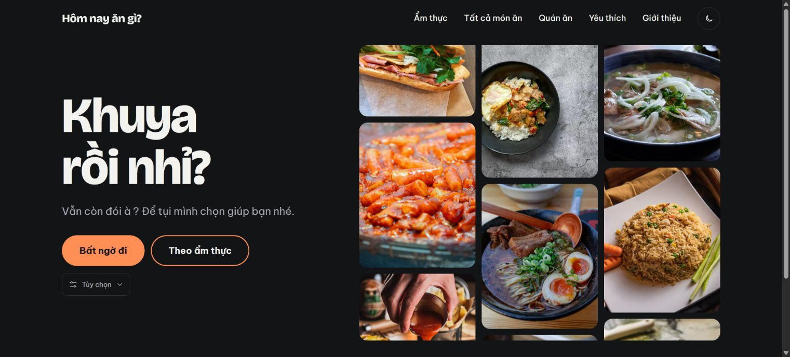
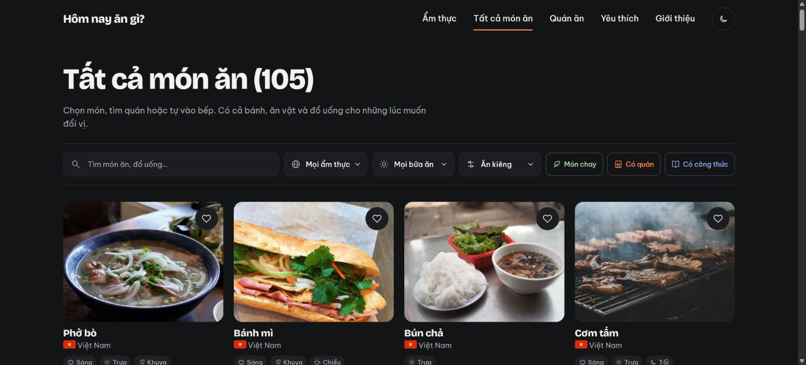
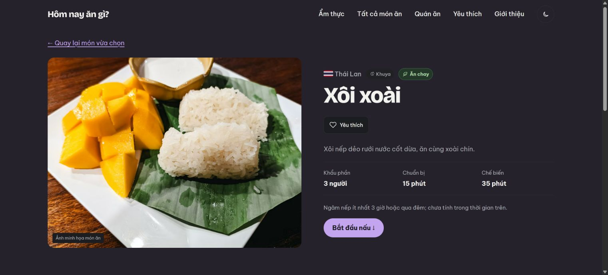
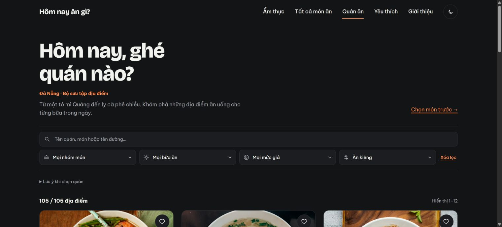
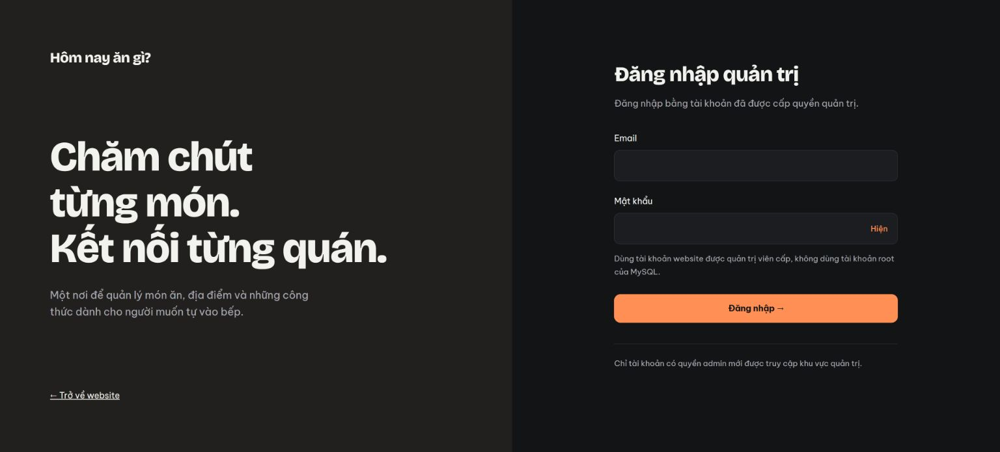
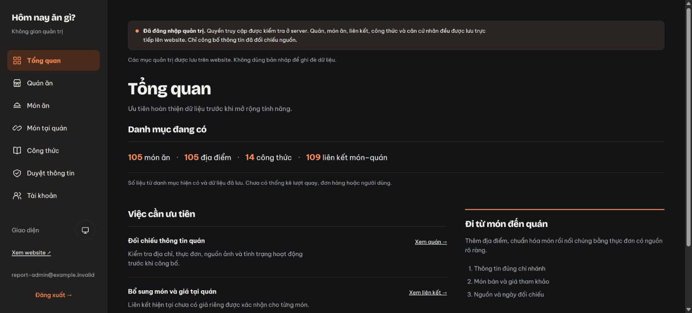
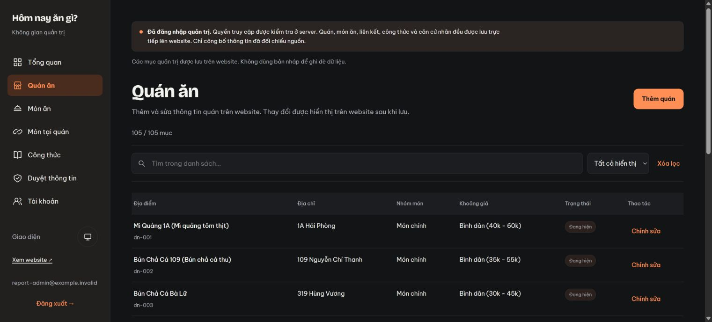
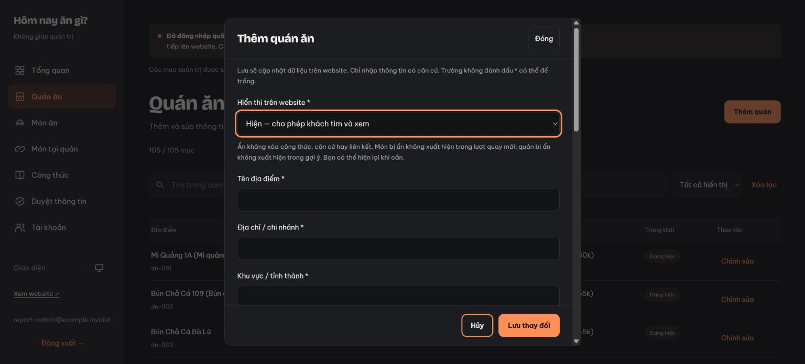

# Báo cáo đồ án Hôm nay ăn gì

Gợi ý món ăn và kết nối thông tin quán cùng công thức nấu ăn

Môn học Advanced Web Design · Nhóm 3

Ngày hoàn thiện báo cáo 07/11/2026 · Phiên bản mã nguồn 87a232a

Website https://hom-nay-an-gi-nhom3.vercel.app

**Bảng 1 Thông tin hoàn thiện trước khi nộp**

|Nội dung|Thông tin|
|---|---|
|Trường và khoa|[Điền theo thông tin của nhóm]|
|Giảng viên hướng dẫn|[Điền tên giảng viên]|
|Thành viên và mã sinh viên|[Điền danh sách chính thức]|
|Lớp và học kỳ|[Điền theo yêu cầu môn học]|

## Tóm tắt và phạm vi đánh giá

Đồ án xây dựng website giúp người dùng lựa chọn món ăn theo điều kiện, xem công thức hoặc tìm địa điểm có thông tin món phù hợp. Frontend HTML CSS JavaScript kết hợp backend Node.js theo MVC, MySQL 8.4, Aiven và Vercel. Website không dùng EJS hoặc Express.

Bản báo cáo bổ sung yêu cầu, Use Case, sơ đồ kiến trúc, ERD, từ điển dữ liệu sau migration, phân tích code theo luồng và minh chứng giao diện. Các ảnh khách được chụp từ website production ngày 07/11/2026. Ảnh admin được chụp trên server local cùng mã nguồn và dữ liệu seed trong MySQL cách ly; không coi những ảnh này là bằng chứng ghi dữ liệu production.

Kết quả ngày 06/11/2026 đã ghi nhận 29 test đạt và 1 bỏ qua, cùng kiểm tra thêm sửa quán và đăng xuất thật trên Vercel. Lần chạy lại ngày 07/11/2026 cho 28 đạt, 1 lỗi ở bài mysql-models và 1 bỏ qua. Lỗi mới nằm trong kịch bản cố ý dùng database không tồn tại và phần dọn kết nối; worker chờ lâu được dừng riêng. Chưa kết luận website production có cùng lỗi trong luồng bình thường. Chi tiết và log nằm ở chương kiểm thử.

Giới hạn phạm vi: yêu thích vẫn lưu trên trình duyệt; không có tài khoản khách đồng bộ, đơn hàng, thanh toán hoặc điều phối shipper. Nút GrabFood và ShopeeFood mở nền tảng ngoài. Thông tin nguồn và dinh dưỡng cần được giữ đúng phiên bản áp dụng.

## 1 Mục tiêu và phạm vi

### 1.1 Vấn đề cần giải quyết

Người dùng thường khó quyết định ăn gì, muốn tìm món hợp bữa hoặc chế độ ăn, sau đó cần biết có thể tự nấu hay tìm quán nào có món đó. Website tạo một luồng ngắn: chọn điều kiện, quay món, xem thông tin món và tiếp tục đến công thức hoặc quán liên quan. Thông tin quán và công thức được quản lý tập trung để có thể bổ sung sau khi đưa website lên Internet.

### 1.2 Hai nhóm người sử dụng

• Khách truy cập xem danh mục, lọc và quay món, đọc công thức, tìm địa điểm, lưu yêu thích trên trình duyệt và mở liên kết ngoài.

• Quản trị viên đăng nhập bằng tài khoản đã được cấp, quản lý món, quán, liên kết, công thức và căn cứ nhãn. Người truy cập bình thường không được phép ghi các danh mục này.

### 1.3 Quy mô dữ liệu của phiên bản đã kiểm tra

Danh mục cơ sở gồm 105 món ăn, bánh và đồ uống; 105 địa điểm tại Đà Nẵng; 7 nhóm ẩm thực; 14 công thức; 109 liên kết món với quán. Đây là số liệu của bản đã đối chiếu khi kiểm thử ngày 06/11/2026, không phải chỉ số tự cập nhật trong báo cáo. Các thay đổi admin về sau có thể làm số lượng khác đi.

105 địa điểm ban đầu được chuyển đổi từ danh sách Excel do người dùng cung cấp. Sau quá trình chuẩn hóa và nhập, website đang chạy đọc dữ liệu MySQL. Tệp Excel không phải nguồn dữ liệu được đọc trực tiếp ở mỗi lần khách mở trang. Ảnh minh họa được phân biệt với ảnh thật của quán; chưa biết thông tin thì để trống hoặc hiển thị trạng thái chưa có thông tin.

### 1.4 Yêu cầu chức năng và tiêu chí chấp nhận

**Bảng 2 Yêu cầu chức năng**

|Mã|Yêu cầu và kết quả chấp nhận|Cách đối chiếu|
|---|---|---|
|FR01|Danh mục đọc từ MySQL, không dùng bản JSON cũ khi API lỗi|Model và HTTP 503|
|FR02|Quay trong đúng tập đã lọc, không bỏ điều kiện ngầm|spin-filters và test tập món|
|FR03|Hiện quán có liên kết đúng món, tách biến thể liên quan|restaurant_dishes.match_type|
|FR04|Công thức có nguồn và tính lượng cho 1 đến 12 người|recipe.js và test định lượng|
|FR05|Nhãn có popup và phạm vi áp dụng rõ|dish_reviews và validators|
|FR06|Yêu thích lưu ID cục bộ, có phản hồi lỗi ghi|favorites.js|
|FR07|Đăng nhập tạo phiên thật và kiểm tra role ở server|Better Auth và middleware|
|FR08|Ghi danh mục có transaction, revision và audit|Models quản trị và test rollback|
|FR09|Ẩn hiện tác động đồng bộ lên nội dung công khai|is_visible và test visibility|
|FR10|Đăng xuất thu hồi phiên ở MySQL|Kiểm tra phiên và mở lại admin|

### 1.5 Yêu cầu phi chức năng và phạm vi chứng minh

**Bảng 3 Yêu cầu chất lượng**

|Thuộc tính|Yêu cầu|Giới hạn bằng chứng|
|---|---|---|
|An toàn|Phân quyền server, tham số SQL, TLS và cookie phù hợp|Chưa có audit bảo mật độc lập|
|Toàn vẹn|Ghi nguyên tử và ngăn ghi đè phiên bản cũ|Test transaction và 409|
|Khả dụng|Thông báo lỗi thay vì dùng dữ liệu cũ giả thành công|Chưa chứng minh uptime dài hạn|
|Hiệu năng|Giới hạn kết nối và có dọn idle|Chưa có kiểm thử tải lớn hoặc SLA|
|Sử dụng|Responsive, nhãn điều khiển và giảm chuyển động|Không khẳng định chứng nhận accessibility|
|Bảo trì|MVC, migration, seed, test và tài liệu riêng|Thành viên vẫn phải tự dựng môi trường|

**Hình 1 Use Case tổng quan theo hai vai trò**

Sơ đồ dựng từ cấu trúc và luồng trong code dự án.

**Bảng 4 Đặc tả Use Case chính**

|Use Case|Tác nhân và tiền điều kiện|Luồng chính|Ngoại lệ|
|---|---|---|---|
|UC01 Quay món|Khách; Có danh mục tải thành công|Chọn điều kiện → xem số món → quay → xem kết quả|Không có món thì khóa quay; không tự bỏ lọc|
|UC02 Xem quán theo món|Khách; Món đang công khai|Mở kết quả → tải API liên kết → mở chi tiết quán|Không có liên kết phải báo rõ; không suy đoán quán bán|
|UC03 Đọc công thức|Khách; Món và công thức được công bố|Mở công thức → đổi người ăn → đánh dấu bước|Chưa có công thức thì hiện trạng thái cập nhật|
|UC04 Lưu yêu thích|Khách; Trình duyệt cho phép storage|Bấm trái tim → ghi ID → cập nhật trạng thái|Ghi thất bại phải báo lỗi, không hiện lưu giả|
|UC05 Đăng nhập|Admin; Tài khoản được cấp role admin|Nhập email mật khẩu → xác thực → cookie → kiểm tra role|Sai mật khẩu 401; thiếu quyền 403; quá lượt 429|
|UC06 Thêm sửa quán|Admin; Phiên hợp lệ và quyền admin|Mở form → validate → transaction → lưu audit → tải lại|Dữ liệu sai 400; revision cũ 409; lỗi thì rollback|
|UC07 Duyệt nhãn|Admin; Có nguồn và định lượng đủ căn cứ|Chọn món → nhập nguồn phạm vi → kiểm tra → công bố|Không đủ căn cứ thì không gán; thu hồi khi cần|
|UC08 Đăng xuất|Admin; Có phiên đăng nhập|Bấm đăng xuất → server thu hồi phiên → về đăng nhập|Nếu lỗi không giả vờ đã thu hồi thành công|

Quy tắc nghiệp vụ xuyên suốt: không bịa dữ liệu quán; giá quán và giá từng món là hai loại thông tin; một nhãn của phiên bản nguồn không tự áp dụng cho mọi công thức hoặc mọi quán. Ẩn nội dung là thay đổi quyền công khai, không phải xóa dữ liệu. Khách không được quyết định role bằng dữ liệu gửi từ trình duyệt.

## 2 Công nghệ và cách tổ chức MVC

### 2.1 Công nghệ sử dụng

• HTML xây dựng cấu trúc trang; CSS tạo bố cục responsive, màu sắc, thẻ thông tin, modal và chuyển động.

• JavaScript phía trình duyệt xử lý DOM, bộ lọc, quay món, khẩu phần, đánh dấu bước nấu và lưu trữ cục bộ.

• Node.js 24.x chạy backend HTTP bằng module node:http. Dự án không sử dụng Express và không sử dụng EJS.

• MySQL 8.4 LTS lưu dữ liệu có quan hệ; mysql2/promise cung cấp pool và truy vấn bất đồng bộ với tham số.

• Better Auth xử lý xác thực email và mật khẩu, phiên đăng nhập và giới hạn tần suất.

• Aiven cung cấp MySQL online với kết nối TLS kiểm tra chứng chỉ CA. Vercel chạy website và Node Function. GitHub lưu code, schema, migration và seed.

Phiên bản package được khóa trong package-lock.json. package.json của bản đối chiếu khai báo mysql2 ^3.24.6, better-auth ^1.7.16 và @vercel/functions ^3.10.6. Không nên suy ra rằng đây luôn là phiên bản mới nhất của các thư viện.

### 2.2 MVC trong dự án không dùng EJS

View là các file HTML/CSS/JS trong public. Controller nhận thông tin yêu cầu, kiểm tra định dạng tham số và điều phối việc gọi Model. Model truy vấn MySQL, ánh xạ bản ghi sang dữ liệu frontend hoặc ghi nhiều bảng trong transaction. Route xác định URL và phương thức HTTP để chuyển yêu cầu đến đúng controller. MVC không bắt buộc View phải là EJS; trong dự án này trình duyệt dựng giao diện từ HTML và dữ liệu do backend cung cấp.

Luồng đọc cơ bản là Trình duyệt → Route → Controller → Model → mysql2 → MySQL → JSON → giao diện. Với dữ liệu FOOD và RECIPES, Node trả JavaScript được sinh từ database để các script frontend hiện có tiếp tục dùng cùng tên biến.

### 2.3 Cấu trúc thư mục

```javascript
api/index.js                 Điểm vào Node Function trên Vercel
public/                      View và tài nguyên gửi xuống trình duyệt
  *.html                     Các trang khách và quản trị
  css/                       Giao diện và responsive
  js/                        Tương tác, API client và bộ lọc
  images/                    Logo, cờ, placeholder và ảnh
server/app.js                Bộ xử lý HTTP và file tĩnh có kiểm soát
server/routes/               Phân luồng URL và phương thức
server/controllers/          Điều phối yêu cầu
server/models/               Đọc và ghi MySQL
server/config/               Cấu hình database và Better Auth
server/middleware/           Xác thực và phân quyền
server/validators/           Ràng buộc dữ liệu đầu vào
server/services/             Tác vụ như cấp tài khoản admin
server/utils/                JSON, Origin và xử lý IP
database/schema.sql          Cấu trúc database ban đầu
database/migrations/         Các thay đổi schema có phiên bản
data/                        Nguồn seed đã chuẩn hóa
scripts/                     Nhập dữ liệu, test và build
tests/                       Kiểm thử tự động
docs/                        Hướng dẫn phát triển và vận hành
vercel.json                  Build, đóng gói Function và route
```

server/views được dành sẵn cho trường hợp cần template về sau; View đang sử dụng thực tế vẫn là public. node_modules là thư viện được cài từ npm, không phải phần mã nguồn tự viết để nộp hoặc commit.

**Hình 2 Kiến trúc triển khai và ranh giới lưu trữ**

Sơ đồ dựng từ cấu trúc và luồng trong code dự án.

**Bảng 5 Lý do lựa chọn kỹ thuật**

|Quyết định|Lợi ích trong đồ án|Đánh đổi|
|---|---|---|
|HTML và JavaScript thuần|Giữ giao diện đã xây, không cần chuyển template|Cần tự quản lý trạng thái và trạng thái lỗi|
|node:http thay Express|Ít lớp trung gian, dùng lại handler trên Vercel|Tự xử lý body, route và MIME|
|MySQL thay dữ liệu JSON runtime|Quan hệ, foreign key, transaction và phiên thật|Phải quản lý schema và kết nối|
|Better Auth|Tái sử dụng cơ chế phiên và xác thực của thư viện|Cần cấu hình bảng và Origin chính xác|
|Aiven và Vercel|Tách database online khỏi máy thành viên|Có giới hạn tài nguyên và độ trễ mạng|

View chỉ điều khiển trải nghiệm và gửi dữ liệu; không được quyết định quyền ghi. Route chọn controller, controller gọi validator và Model, còn Model chịu trách nhiệm tính nguyên tử. Tên thư mục giúp phân trách nhiệm nhưng tính đúng đắn vẫn phụ thuộc việc kiểm tra tại server. Các trường hợp nghiệp vụ phức tạp như thu hồi căn cứ sau sửa công thức nằm ở luồng Model quản trị, không chỉ xử lý bằng cách ẩn nút.

## 3 Các trang và trải nghiệm người dùng

### 3.1 Trang chủ và lựa chọn món

index.html chào người dùng theo giờ và cung cấp nút Bất ngờ đi, lựa chọn theo ẩm thực và khu vực Tùy chọn thu gọn. Tùy chọn gồm chế độ ăn, Có công thức, Có quán và số món khớp. Người dùng có thể bắt đầu nhanh hoặc giới hạn tập món trước khi quay. Trạng thái không có món phù hợp được thể hiện rõ; hệ thống không tự bỏ bộ lọc để trả một món ngoài yêu cầu.

cuisines.html hiển thị các nền ẩm thực và lối vào popup quay bất ngờ dùng chung logic điều kiện. Giao diện dùng biểu tượng, cờ và màu tương ứng, có hỗ trợ giảm chuyển động theo cài đặt thiết bị.

### 3.2 Trang kết quả quay

result.html đọc điều kiện trên URL, xác định tập món hợp lệ và chạy hoạt ảnh đổi tên cùng hình ảnh món. Sau khi dừng, trang hiện tên, mô tả, quốc gia kèm cờ, thẻ bữa ăn và nhãn ăn uống đủ điều kiện. Các hành động gồm quay lại, tìm trên Google Maps, mở lựa chọn nền tảng giao đồ ăn và xem công thức.

Danh sách quán phù hợp được tải và đặt ngay dưới kết quả. Tên món giống nhau không đủ để kết luận mọi quán đều bán; bộ dữ liệu quan hệ quyết định món có liên kết chính xác hay chỉ có biến thể liên quan. Nhãn và trạng thái thiếu công thức không được thay bằng nội dung suy đoán.

### 3.3 Danh mục món và quán

dishes.html có tìm theo tên, lọc ẩm thực, bữa ăn, chế độ ăn, Món chay, Có quán và Có công thức. Các thẻ món dẫn về thông tin món hoặc công thức, có nút trái tim và các thẻ bữa ăn có icon. restaurants.html tìm theo dữ liệu quán, lọc nhóm món, bữa và khoảng giá, phân trang kết quả từ API. Các dropdown có giao diện đồng bộ thay vì chỉ dùng hình thức mặc định của trình duyệt.

restaurant.html hiển thị thông tin một địa điểm, địa chỉ, nhóm món, giá tham khảo, bữa gợi ý và những thông tin bổ sung đã có. Khoảng giá của quán không được xem là giá xác nhận của một món cụ thể. Các trường chưa có nguồn không tự điền giờ mở cửa, số điện thoại hoặc tình trạng hợp tác.

### 3.4 Công thức và yêu thích

recipe.html trình bày ảnh, thông tin món, thời gian chuẩn bị và chế biến, nguyên liệu, các bước, mẹo và nguồn tham khảo. Người dùng chọn 1–12 người ăn; nguyên liệu dạng số hoặc khoảng số được tính theo tỷ lệ. Lượng dạng văn bản như một ít giữ nguyên. Thời gian nấu không tự tăng theo tỷ lệ khẩu phần. Checkbox nguyên liệu và bước nấu cập nhật số lượng hoàn thành và thanh tiến độ trong trang.

favorites.html đọc danh sách ID món và quán từ localStorage. Khách không cần đăng nhập để lưu trên thiết bị hiện tại. Các tab cùng origin có thể cập nhật trạng thái qua sự kiện storage. Đổi trình duyệt, xóa dữ liệu trang hoặc đổi tên miền sẽ không tự mang danh sách cũ theo. Không có API đồng bộ yêu thích vào tài khoản khách ở phiên bản này.

### 3.5 Giao diện sáng tối và hỗ trợ thao tác

Nút icon mở lựa chọn Sáng, Tối, Theo hệ thống; lựa chọn được lưu cục bộ. Chế độ hệ thống phản ứng với prefers-color-scheme. Hiệu ứng chuyển màu, icon và quay món có xét prefers-reduced-motion. Các trang có nhãn điều khiển, trạng thái disabled, skip link, xử lý bàn phím và bố cục trên màn hình nhỏ. Những hỗ trợ này cải thiện khả năng sử dụng; báo cáo không xem chúng là chứng nhận đạt một tiêu chuẩn accessibility toàn diện.

### 3.6 Minh họa giao diện và nhiệm vụ từng màn hình

Ảnh chụp ngày 07/11/2026. Điểm vào chính là Bất ngờ đi; Tùy chọn được thu gọn để không làm chậm người muốn chọn nhanh. Lời chào phụ thuộc giờ thiết bị, không phải một giá trị cố định trong database.



Danh mục được dựng từ dữ liệu động. Khi demo cần thử kết hợp Có công thức với Món chay, rồi xóa bộ lọc; số lượng và tập món phải thay đổi cùng nhau. Chữ quốc gia và icon bữa ăn cần giữ ý nghĩa ngay cả khi không phân biệt màu.



Ảnh phần đầu trang cho thấy nhãn, nguồn ngữ cảnh món và khẩu phần. Phần nguyên liệu và bước nằm tiếp bên dưới. Hình minh họa món không phải bằng chứng về suất ăn của một nhà hàng.



Thông tin được đọc từ API. Bữa và giá tham khảo hỗ trợ thu hẹp kết quả; chưa có dữ liệu không được tự chuyển thành giá cố định. Danh sách không tự khẳng định quán đang mở cửa thời gian thực.



Ảnh local dùng cùng giao diện với production và chưa nhập thông tin xác thực. Tài khoản thử được tạo riêng, database và khóa phiên tạm đã được dọn sau phiên chụp. Ảnh này minh họa giao diện, không thay thế kiểm thử đăng nhập production ngày 06/11.



Các số 105 món, 105 quán, 14 công thức và 109 liên kết là số lượng danh mục, không phải lượt xem hoặc đơn hàng. Ảnh được chụp local sau đăng nhập bằng tài khoản thử, không chứa tài khoản thật hoặc token.



Admin có phân trang, tìm kiếm và lọc hiển thị. Dữ liệu ở ảnh là seed cách ly. Các thao tác ghi production đã được kiểm tra riêng và được mô tả trong chương kiểm thử.



Mở form để minh họa, không bấm lưu và không tạo quán mới trong quá trình chụp. Các trường bắt buộc được đánh dấu; trường chưa biết để trống. Trạng thái ẩn giữ dữ liệu trong admin và loại khỏi các luồng công khai.



### 3.7 Tiêu chí kiểm tra bố cục điện thoại

Ở màn hình nhỏ cần kiểm tra menu có mở được bằng bàn phím/cảm ứng, nút quay không bị che, dropdown không tràn ngang, modal có vùng cuộn và nút đóng luôn tiếp cận được. Công thức cần xếp ảnh và thông tin theo chiều dọc; bảng admin cần cách cuộn hoặc trình bày không làm mất thao tác sửa. Báo cáo không đưa ảnh thử kích thước 390 pixel vào làm bằng chứng vì ảnh thu được không đủ chất lượng để kết luận đúng về viewport điện thoại.

## 4 Thuật toán quay món và bộ lọc

### 4.1 Tập món hợp lệ

SpinFilters.parse đọc diet, recipe và linked từ query string. Diet thuộc các giá trị được whitelist; recipe=1 yêu cầu có công thức; linked=1 yêu cầu có quán liên kết chính xác. SpinFilters.apply dùng chung cho số món hiển thị và tập món thực sự được quay. Vì dùng cùng logic, số lượng trên giao diện và kết quả quay không được tính theo hai tiêu chí khác nhau.

Sau khi lọc, App.pickDish ưu tiên món phù hợp bữa hiện tại và không trùng món vừa ra. Nếu không có món đạt cả hai, hàm chọn từ tập đã lọc nhưng khác món trước; cuối cùng mới dùng toàn bộ tập đã lọc. Việc ưu tiên bữa không được phép đưa một món bị loại bởi điều kiện chay/công thức/quán quay trở lại.

### 4.2 Giờ và tính ngẫu nhiên

Giờ thiết bị được chia thành Sáng từ 05:00 đến trước 11:00; Trưa từ 11:00 đến trước 13:00; Chiều từ 13:00 đến trước 18:00; Tối từ 18:00 đến trước 22:00; các giờ còn lại là Khuya. Món trước được lưu bằng sessionStorage. Chọn phần tử dùng Math.random với chỉ số làm tròn xuống. Đây là gợi ý ngẫu nhiên đơn giản có ưu tiên, không phải AI cá nhân hóa hay thuật toán chứng minh phân phối công bằng cho toàn bộ danh mục.

### 4.3 Hoạt ảnh và URL

Hoạt ảnh là lớp trải nghiệm trước khi chốt kết quả. Điều kiện và mã món đi qua URL để tải lại hoặc chia sẻ. Các thành phần khóa thao tác phù hợp trong lúc quay; khi hết món, trang hiển thị trạng thái rỗng. Thông tin lọc trong URL không tạo bản ghi database và không phải một cơ chế phân quyền.

### 4.4 Ví dụ chạy qua bộ lọc và thứ tự ưu tiên

Giả sử tập món gốc có A, B và C. A có công thức và nhãn chay; B có công thức nhưng không có căn cứ chay; C chay nhưng chưa có công thức. Chọn Món chay và Có công thức chỉ còn A. Nếu A là món vừa quay trước đó, tầng ưu tiên cuối vẫn cho phép A vì không có món thay thế trong tập hợp lệ. Không được lấy B chỉ để tránh lặp. Ví dụ này là minh họa thuật toán, không phải ba bản ghi mới trong database.

```javascript minh họa luồng
options = SpinFilters.parse(new URLSearchParams(location.search));
validDishes = SpinFilters.apply(FOOD.DISHES, options);
// Trước khi gọi pickDish cần xử lý tập rỗng.
if (validDishes.length === 0) showEmptyState();
else selectedDish = App.pickDish(validDishes);
```

Đoạn trên minh họa sự nối kết giữa các hàm, không được ghi là trích nguyên file. Code thật của parse, apply và pickDish nằm ở phụ lục. Độ phức tạp của lọc và tạo các tầng chọn là O(n) theo số món. Với 105 món, cách làm đơn giản dễ kiểm tra hơn việc thêm hệ thống đề xuất phức tạp chưa có dữ liệu hành vi.

## 5 Quán liên quan và nền tảng bên ngoài

### 5.1 Liên kết món với quán

restaurant_dishes là bảng nối nhiều món với nhiều quán. Phân loại dish nghĩa là bán đúng món được đối chiếu; related là biến thể hoặc món gần nhau và cần tách biệt khi hiển thị. Liên kết có tên món trong thực đơn, nguồn, căn cứ đối chiếu và giá mỗi phần nếu đã có. Quán hoặc món bị ẩn không được xuất hiện trong gợi ý công khai. Liên kết ngừng công bố được giữ lại trong admin để có thể khôi phục.

API GET /api/dishes/:id/restaurants cấp dữ liệu quán theo món. Kết quả dựa vào quan hệ đã lưu, không tự tìm toàn bộ quán trên Google Maps ở mỗi lần quay. Dữ liệu quán cần tiếp tục được kiểm tra với nguồn thật trước khi xem là thông tin kinh doanh hiện hành.

### 5.2 Google Maps và giao đồ ăn

Nút Maps tạo URL tìm kiếm với tên món hoặc tên và địa chỉ quán được encode. Website không sở hữu database Google Maps và không khẳng định đã trích xuất toàn bộ dữ liệu quán từ dịch vụ đó.

GrabFood và ShopeeFood mở nền tảng bên ngoài. Popup có danh sách 63 tỉnh thành theo địa giới cũ đã chọn trong thiết kế, lưu lựa chọn khu vực và hướng dẫn người dùng chọn địa chỉ trên nền tảng rồi tìm món. Lựa chọn này không thiết lập địa chỉ giao hàng thật của GrabFood/ShopeeFood và không đảm bảo một đường dẫn tìm kiếm theo tỉnh sẽ luôn được các hãng hỗ trợ.

Website chưa tạo đơn, chưa thu tiền, chưa nhận trạng thái giao hàng và chưa điều phối shipper. Nếu mở rộng phần này phải làm rõ quyền tích hợp, API đối tác, quản lý địa chỉ, món/giá thực tế và vòng đời đơn hàng; chỉ có logo hoặc liên kết không tương đương tích hợp đặt hàng.

## 6 Nhãn ăn chay và dinh dưỡng

Nhãn Ăn chay cần thông tin nguyên liệu, điều kiện áp dụng và nguồn. Phiên bản món theo một nguồn có thể đủ điều kiện, nhưng phiên bản tại quán chưa chắc giống nhau. Mức nguồn tự công bố phải được phân biệt với mức đã rà soát; không suy đoán một món là chay chỉ từ tên hoặc việc không thấy thịt trong ảnh.

Nhãn dinh dưỡng cũng giới hạn theo phiên bản nguồn và khẩu phần có định lượng. Form admin thu thập g hoặc ml, năng lượng, đường, carbohydrate, nguồn và giới hạn áp dụng. Các tiêu chí ít đường và ít năng lượng được kiểm tra theo số liệu chuẩn hóa 100 g hoặc 100 ml trong code. Không biến một nhãn của nguyên liệu riêng thành kết luận dinh dưỡng cho toàn bộ suất ăn.

Popup của nhãn cho xem tiêu chí, khẩu phần, nguyên liệu hoặc số liệu, điều kiện và nguồn thay vì chỉ có một biểu tượng. Phía giao diện có lựa chọn ít tinh bột, nhưng quản trị chưa hỗ trợ công bố nhãn mới này khi chưa có tiêu chí phù hợp. Không gán đại để tăng số lượng kết quả.

Khi công thức được sửa, xác minh chay dạng reviewed liên quan được thu hồi và ghi lịch sử để rà soát lại. Những căn cứ chỉ áp dụng cho nguồn riêng không tự xác nhận công thức vừa sửa. Đây là quản lý phạm vi dữ liệu, không phải tư vấn dinh dưỡng hoặc chứng nhận suất ăn của quán.

## 7 Thiết kế MySQL và vòng đời dữ liệu

### 7.1 Nhóm bảng

• Danh mục: meals, cuisines, dishes, restaurants, dish_meals, restaurant_meals, restaurant_dishes.

• Công thức và căn cứ: recipes, recipe_ingredients, recipe_steps, dish_reviews, dish_nutrition_profiles.

• Xác thực: users, auth_accounts, auth_sessions, auth_verifications, auth_rate_limits.

• Nền tảng quản lý: schema_versions, seed_imports, dataset_documents, restaurant_audit, dish_audit, admin_catalog_versions, admin_catalog_audit.

• Dự phòng cho yêu thích tài khoản: favorite_dishes, favorite_restaurants. Có bảng không đồng nghĩa tính năng đồng bộ đã được triển khai.

Tổng cấu trúc có 26 bảng sau các migration của phiên bản này. Migration 006 bổ sung cột is_visible cho món và quán, mặc định hiện đối với dữ liệu cũ, không thêm bảng mới.

### 7.2 Quan hệ chính

Một nền ẩm thực có nhiều món. Một món có thể phù hợp nhiều bữa qua dish_meals. Một quán có nhiều bữa gợi ý qua restaurant_meals. Món và quán liên kết nhiều-nhiều qua restaurant_dishes. Mỗi món có công thức được quản lý gắn với danh sách nguyên liệu và bước nấu theo thứ tự. Người dùng có nhiều bản ghi phiên và thông tin xác thực. Audit gắn người sửa với bản trước/sau để theo dõi thay đổi.

Foreign key giúp ngăn bản ghi con trỏ đến món/quán không tồn tại. Các cột và ràng buộc chi tiết nằm trong database/schema.sql và các file migration kèm gói nguồn. Dữ liệu có quan hệ được tách bảng để truy vấn và cập nhật có kiểm soát; một số nguồn gốc/căn cứ vẫn dùng JSON để giữ được nội dung có cấu trúc linh hoạt.

### 7.3 Schema và seed

schema.sql mô tả cấu trúc, không phải bản sao đầy đủ của database production. data chứa nguồn seed được chuẩn hóa; scripts/import-mysql.mjs kiểm tra dữ liệu, áp dụng schema/migration theo chế độ chạy và nhập dữ liệu khởi tạo. db:check kiểm tra nguồn mà không kết nối MySQL. db:setup được dùng khi dựng database riêng hoặc cập nhật cấu trúc theo hướng dẫn, không chạy tự động trong build Vercel.

Database đã sửa trên Aiven không tự xuất ngược vào JSON. Thành viên lấy code từ Git không tự nhận dữ liệu sống của Aiven, tài khoản admin hay mật khẩu. Muốn cùng dữ liệu cần cấu hình kết nối tới môi trường dùng chung được cấp quyền, hoặc nhập bản sao an toàn vào database riêng.

### 7.4 Đọc dữ liệu động

Model thực thi SELECT bằng pool mysql2 rồi ánh xạ dữ liệu thành đối tượng frontend. GET /js/data.js sinh const FOOD từ MySQL; GET /js/recipes.js sinh const RECIPES. Hai đường dẫn này được xử lý trước phục vụ tĩnh, kể cả alias đường dẫn được chuẩn hóa, tránh để bản seed tĩnh làm lộ mục đã ẩn.

Khi database không kết nối được, API trả 503 và thông báo chung, không tự dùng JSON cũ để tạo cảm giác dữ liệu đã cập nhật. Cách này giữ tính nhất quán với trạng thái ẩn và nội dung quản trị; đổi lại frontend cần có thông báo tải lỗi rõ ràng và cơ chế thử lại phù hợp nếu tiếp tục hoàn thiện.

### 7.5 ERD theo nhóm dữ liệu

**Hình 11 Quan hệ danh mục món quán và bữa ăn**

Sơ đồ dựng từ cấu trúc và luồng trong code dự án.

Ký hiệu 1 N chỉ một-nhiều; bảng nối tạo quan hệ nhiều-nhiều giữa hai bảng chính. Mũi tên trong hình thể hiện hướng tham chiếu hoặc liên kết logic. cuisines.cover_dish_id còn tham chiếu ngược tới dishes làm món bìa; foreign key này được thêm sau khi tạo dishes để xử lý vòng tham chiếu. Danh sách khóa ngoại đầy đủ được trích từ schema đã áp dụng ở phụ lục dữ liệu.

**Hình 12 Quan hệ công thức nguyên liệu bước và căn cứ**

Sơ đồ dựng từ cấu trúc và luồng trong code dự án.

Mỗi dish_id có tối đa một recipe đang được quản lý. recipe_ingredients và recipe_steps dùng khóa ghép với sort_order để giữ thứ tự. dish_reviews có thể có nhiều review_key cho cùng một món. Giá trị 0..1 diễn đạt một món có thể chưa có công thức hoặc hồ sơ dinh dưỡng.

**Hình 13 Quan hệ tài khoản phiên và lịch sử quản trị**

Sơ đồ dựng từ cấu trúc và luồng trong code dự án.

### 7.6 Từ điển dữ liệu sau đầy đủ migration

Bảng dưới lấy từ information_schema của MySQL cách ly sau applySchema; không lấy cấu trúc cũ trong schema.sql rồi bỏ qua migration. PRI là thành phần khóa chính, UNI là khóa duy nhất, MUL là cột thuộc chỉ mục không duy nhất. Cột FK có tham chiếu được nêu kèm. Ký hiệu NULL là được phép thiếu; NOT NULL là bắt buộc. Mặc định không được diễn giải là giá trị thực tế của một bản ghi.

### admin_catalog_audit

Lịch sử liên kết công thức và căn cứ nhãn.

**Bảng 6 Cấu trúc admin_catalog_audit**

|Trường|Kiểu MySQL|Ràng buộc|Ý nghĩa|
|---|---|---|---|
|id|bigint unsigned|NOT NULL; PRI|Định danh bản ghi auto_increment.|
|kind|enum('links','recipes','reviews')|NOT NULL; MUL|Nhóm danh mục quản trị|
|entity_key|varchar(255)|NOT NULL; —|Mã mục trong nhóm|
|actor_user_id|bigint unsigned|NOT NULL; MUL; FK users.id|Người thực hiện thay đổi|
|before_data|json|NULL; —|Dữ liệu trước thay đổi|
|after_data|json|NOT NULL; —|Dữ liệu sau thay đổi|
|created_at|datetime(3)|NOT NULL; —|Thời điểm tạo Mặc định CURRENT_TIMESTAMP(3). DEFAULT_GENERATED.|

### admin_catalog_versions

Phiên bản và nhận diện request ghi danh mục.

**Bảng 7 Cấu trúc admin_catalog_versions**

|Trường|Kiểu MySQL|Ràng buộc|Ý nghĩa|
|---|---|---|---|
|kind|enum('links','recipes','reviews')|NOT NULL; PRI|Nhóm danh mục quản trị|
|entity_key|varchar(255)|NOT NULL; PRI|Mã mục trong nhóm|
|revision|int unsigned|NOT NULL; —|Phiên bản chống ghi đè Mặc định 1.|
|last_request_id|char(36)|NULL; —|UUID yêu cầu ghi gần nhất|
|last_actor_id|bigint unsigned|NULL; —|Người gửi yêu cầu gần nhất|
|last_payload|json|NULL; —|Nội dung yêu cầu gần nhất để chống ghi lặp|

### auth_accounts

Thông tin xác thực của provider, gồm mã băm mật khẩu.

**Bảng 8 Cấu trúc auth_accounts**

|Trường|Kiểu MySQL|Ràng buộc|Ý nghĩa|
|---|---|---|---|
|id|bigint unsigned|NOT NULL; PRI|Định danh bản ghi auto_increment.|
|user_id|bigint unsigned|NOT NULL; MUL; FK users.id|Tài khoản sở hữu|
|account_id|varchar(255)|NOT NULL; —|Thông tin account id theo schema.|
|provider_id|varchar(80)|NOT NULL; MUL|Thông tin provider id theo schema.|
|password|varchar(255)|NULL; —|Mã băm mật khẩu do Better Auth quản lý|
|access_token|text|NULL; —|Thông tin access token theo schema.|
|refresh_token|text|NULL; —|Thông tin refresh token theo schema.|
|id_token|text|NULL; —|Thông tin id token theo schema.|
|access_token_expires_at|datetime(3)|NULL; —|Thông tin access token expires at theo schema.|
|refresh_token_expires_at|datetime(3)|NULL; —|Thông tin refresh token expires at theo schema.|
|scope|text|NULL; —|Thông tin scope theo schema.|
|created_at|datetime(3)|NOT NULL; —|Thời điểm tạo|
|updated_at|datetime(3)|NOT NULL; —|Thời điểm cập nhật|

### auth_rate_limits

Bộ đếm tần suất lưu tại database.

**Bảng 9 Cấu trúc auth_rate_limits**

|Trường|Kiểu MySQL|Ràng buộc|Ý nghĩa|
|---|---|---|---|
|id|bigint unsigned|NOT NULL; PRI|Định danh bản ghi auto_increment.|
|key|varchar(255)|NOT NULL; UNI|Khóa bộ đếm tần suất|
|count|int|NOT NULL; —|Số lượt trong cửa sổ|
|last_request|bigint|NOT NULL; —|Mốc lần yêu cầu gần nhất|

### auth_sessions

Phiên đăng nhập với thời hạn và token duy nhất.

**Bảng 10 Cấu trúc auth_sessions**

|Trường|Kiểu MySQL|Ràng buộc|Ý nghĩa|
|---|---|---|---|
|id|bigint unsigned|NOT NULL; PRI|Định danh bản ghi auto_increment.|
|user_id|bigint unsigned|NOT NULL; MUL; FK users.id|Tài khoản sở hữu|
|token|varchar(255)|NOT NULL; UNI|Mã phiên nhạy cảm không đưa vào log/báo cáo|
|expires_at|datetime(3)|NOT NULL; MUL|Thời điểm hết hạn|
|created_at|datetime(3)|NOT NULL; —|Thời điểm tạo|
|updated_at|datetime(3)|NOT NULL; —|Thời điểm cập nhật|
|ip_address|varchar(255)|NULL; —|Thông tin ip address theo schema.|
|user_agent|text|NULL; —|Thông tin user agent theo schema.|

### auth_verifications

Bản ghi xác minh phục vụ thư viện auth.

**Bảng 11 Cấu trúc auth_verifications**

|Trường|Kiểu MySQL|Ràng buộc|Ý nghĩa|
|---|---|---|---|
|id|bigint unsigned|NOT NULL; PRI|Định danh bản ghi auto_increment.|
|identifier|varchar(255)|NOT NULL; MUL|Thông tin identifier theo schema.|
|value|text|NOT NULL; —|Thông tin value theo schema.|
|expires_at|datetime(3)|NOT NULL; —|Thời điểm hết hạn|
|created_at|datetime(3)|NOT NULL; —|Thời điểm tạo|
|updated_at|datetime(3)|NOT NULL; —|Thời điểm cập nhật|

### cuisines

Danh mục nền ẩm thực và món ảnh bìa.

**Bảng 12 Cấu trúc cuisines**

|Trường|Kiểu MySQL|Ràng buộc|Ý nghĩa|
|---|---|---|---|
|id|varchar(32)|NOT NULL; PRI|Định danh bản ghi|
|name|varchar(120)|NOT NULL; —|Tên hiển thị|
|description|text|NOT NULL; —|Mô tả nội dung|
|cover_dish_id|varchar(100)|NULL; MUL; FK dishes.id|Mã món dùng làm ảnh bìa|
|icon|varchar(32)|NULL; —|Thông tin icon theo schema.|
|source_record|json|NOT NULL; —|Bản ghi nguồn ban đầu|

### dataset_documents

Lưu tài liệu thứ tự và metadata có cấu trúc JSON.

**Bảng 13 Cấu trúc dataset_documents**

|Trường|Kiểu MySQL|Ràng buộc|Ý nghĩa|
|---|---|---|---|
|id|varchar(80)|NOT NULL; PRI|Định danh bản ghi|
|document|json|NOT NULL; —|Nội dung metadata JSON|

### dish_audit

Lịch sử thêm sửa món và người thực hiện.

**Bảng 14 Cấu trúc dish_audit**

|Trường|Kiểu MySQL|Ràng buộc|Ý nghĩa|
|---|---|---|---|
|id|bigint unsigned|NOT NULL; PRI|Định danh bản ghi auto_increment.|
|dish_id|varchar(100)|NOT NULL; MUL; FK dishes.id|Mã món liên quan|
|actor_user_id|bigint unsigned|NOT NULL; MUL; FK users.id|Người thực hiện thay đổi|
|action|enum('create','update')|NOT NULL; —|Thông tin action theo schema.|
|before_data|json|NULL; —|Dữ liệu trước thay đổi|
|after_data|json|NOT NULL; —|Dữ liệu sau thay đổi|
|created_at|datetime(3)|NOT NULL; —|Thời điểm tạo Mặc định CURRENT_TIMESTAMP(3). DEFAULT_GENERATED.|

### dish_meals

Nối món với nhiều bữa ăn theo thứ tự.

**Bảng 15 Cấu trúc dish_meals**

|Trường|Kiểu MySQL|Ràng buộc|Ý nghĩa|
|---|---|---|---|
|dish_id|varchar(100)|NOT NULL; PRI; FK dishes.id|Mã món liên quan|
|meal_id|varchar(32)|NOT NULL; PRI; FK meals.id|Mã bữa ăn|
|sort_order|smallint unsigned|NOT NULL; —|Thứ tự hiển thị|

### dish_nutrition_profiles

Hồ sơ dinh dưỡng theo phiên bản tham khảo.

**Bảng 16 Cấu trúc dish_nutrition_profiles**

|Trường|Kiểu MySQL|Ràng buộc|Ý nghĩa|
|---|---|---|---|
|dish_id|varchar(100)|NOT NULL; PRI; FK dishes.id|Mã món liên quan|
|profile|json|NOT NULL; —|Số liệu dinh dưỡng có phạm vi|

### dish_reviews

Căn cứ và trạng thái nhãn theo món.

**Bảng 17 Cấu trúc dish_reviews**

|Trường|Kiểu MySQL|Ràng buộc|Ý nghĩa|
|---|---|---|---|
|dish_id|varchar(100)|NOT NULL; PRI; FK dishes.id|Mã món liên quan|
|review_key|varchar(40)|NOT NULL; PRI|Loại nhãn ăn uống|
|status|enum('reviewed','source-declared','verified')|NOT NULL; —|Trạng thái xác minh căn cứ|
|evidence|json|NOT NULL; —|Căn cứ và phạm vi nguồn|

### dishes

Danh mục món, nguồn ảnh, trạng thái và revision.

**Bảng 18 Cấu trúc dishes**

|Trường|Kiểu MySQL|Ràng buộc|Ý nghĩa|
|---|---|---|---|
|id|varchar(100)|NOT NULL; PRI|Định danh bản ghi|
|cuisine_id|varchar(32)|NOT NULL; MUL; FK cuisines.id|Mã nền ẩm thực|
|name|varchar(255)|NOT NULL; MUL|Tên hiển thị|
|description|text|NOT NULL; —|Mô tả nội dung|
|image_url|text|NULL; —|Thông tin image url theo schema.|
|photo_id|varchar(255)|NULL; —|Thông tin photo id theo schema.|
|photo_author|varchar(255)|NULL; —|Thông tin photo author theo schema.|
|photo_crop|varchar(255)|NULL; —|Thông tin photo crop theo schema.|
|image_source|json|NULL; —|Thông tin image source theo schema.|
|provenance|json|NULL; —|Nguồn gốc dữ liệu|
|source_record|json|NOT NULL; —|Bản ghi nguồn ban đầu|
|revision|int unsigned|NOT NULL; —|Phiên bản chống ghi đè Mặc định 1.|
|admin_image_url|text|NULL; —|Thông tin admin image url theo schema.|
|updated_at|datetime(3)|NOT NULL; —|Thời điểm cập nhật Mặc định CURRENT_TIMESTAMP(3). DEFAULT_GENERATED.|
|is_visible|tinyint(1)|NOT NULL; —|Trạng thái công khai Mặc định 1.|

### favorite_dishes

Dự phòng yêu thích món theo tài khoản; chưa nối vào chức năng khách.

**Bảng 19 Cấu trúc favorite_dishes**

|Trường|Kiểu MySQL|Ràng buộc|Ý nghĩa|
|---|---|---|---|
|user_id|bigint unsigned|NOT NULL; PRI; FK users.id|Tài khoản sở hữu|
|dish_id|varchar(100)|NOT NULL; PRI; FK dishes.id|Mã món liên quan|
|created_at|timestamp|NOT NULL; —|Thời điểm tạo Mặc định CURRENT_TIMESTAMP. DEFAULT_GENERATED.|

### favorite_restaurants

Dự phòng yêu thích quán theo tài khoản; chưa nối vào chức năng khách.

**Bảng 20 Cấu trúc favorite_restaurants**

|Trường|Kiểu MySQL|Ràng buộc|Ý nghĩa|
|---|---|---|---|
|user_id|bigint unsigned|NOT NULL; PRI; FK users.id|Tài khoản sở hữu|
|restaurant_id|varchar(100)|NOT NULL; PRI; FK restaurants.id|Mã quán liên quan|
|created_at|timestamp|NOT NULL; —|Thời điểm tạo Mặc định CURRENT_TIMESTAMP. DEFAULT_GENERATED.|

### meals

Danh mục bữa ăn và nhãn hiển thị.

**Bảng 21 Cấu trúc meals**

|Trường|Kiểu MySQL|Ràng buộc|Ý nghĩa|
|---|---|---|---|
|id|varchar(32)|NOT NULL; PRI|Định danh bản ghi|
|label|varchar(80)|NOT NULL; —|Nhãn hiển thị|
|source_record|json|NOT NULL; —|Bản ghi nguồn ban đầu|

### recipe_ingredients

Nguyên liệu có số lượng số hoặc văn bản.

**Bảng 22 Cấu trúc recipe_ingredients**

|Trường|Kiểu MySQL|Ràng buộc|Ý nghĩa|
|---|---|---|---|
|dish_id|varchar(100)|NOT NULL; PRI; FK recipes.dish_id|Mã món liên quan|
|sort_order|smallint unsigned|NOT NULL; PRI|Thứ tự hiển thị|
|name|varchar(255)|NOT NULL; —|Tên hiển thị|
|amount_min|decimal(12,4)|NULL; —|Lượng số hoặc đầu dưới của khoảng|
|amount_max|decimal(12,4)|NULL; —|Đầu trên của khoảng nếu có|
|unit|varchar(80)|NULL; —|Đơn vị nguyên liệu|
|amount_text|varchar(500)|NULL; —|Định lượng văn bản không nhân tỷ lệ|

### recipe_steps

Các bước chế biến theo thứ tự.

**Bảng 23 Cấu trúc recipe_steps**

|Trường|Kiểu MySQL|Ràng buộc|Ý nghĩa|
|---|---|---|---|
|dish_id|varchar(100)|NOT NULL; PRI; FK recipes.dish_id|Mã món liên quan|
|sort_order|smallint unsigned|NOT NULL; PRI|Thứ tự hiển thị|
|title|varchar(255)|NOT NULL; —|Tiêu đề bước|
|instruction|text|NOT NULL; —|Nội dung bước nấu|

### recipes

Công thức gốc theo món và khẩu phần.

**Bảng 24 Cấu trúc recipes**

|Trường|Kiểu MySQL|Ràng buộc|Ý nghĩa|
|---|---|---|---|
|dish_id|varchar(100)|NOT NULL; PRI; FK dishes.id|Mã món liên quan|
|base_servings|smallint unsigned|NOT NULL; —|Khẩu phần gốc từ 1 đến 12|
|prep_time|varchar(255)|NOT NULL; —|Thời gian chuẩn bị dạng văn bản|
|cook_time|varchar(255)|NOT NULL; —|Thời gian nấu dạng văn bản|
|soak_note|text|NULL; —|Thời gian ngâm hoặc ủ riêng|
|tip|text|NOT NULL; —|Mẹo chế biến|
|source_label|varchar(500)|NOT NULL; —|Tên nguồn công thức|
|source_url|text|NOT NULL; —|URL nguồn công thức|
|source_record|json|NOT NULL; —|Bản ghi nguồn ban đầu|

### restaurant_audit

Lịch sử thêm sửa quán và người thực hiện.

**Bảng 25 Cấu trúc restaurant_audit**

|Trường|Kiểu MySQL|Ràng buộc|Ý nghĩa|
|---|---|---|---|
|id|bigint unsigned|NOT NULL; PRI|Định danh bản ghi auto_increment.|
|restaurant_id|varchar(100)|NOT NULL; MUL; FK restaurants.id|Mã quán liên quan|
|actor_user_id|bigint unsigned|NOT NULL; MUL; FK users.id|Người thực hiện thay đổi|
|action|enum('create','update')|NOT NULL; —|Thông tin action theo schema.|
|before_data|json|NULL; —|Dữ liệu trước thay đổi|
|after_data|json|NOT NULL; —|Dữ liệu sau thay đổi|
|created_at|datetime(3)|NOT NULL; —|Thời điểm tạo Mặc định CURRENT_TIMESTAMP(3). DEFAULT_GENERATED.|

### restaurant_dishes

Đối chiếu món hoặc biến thể bán tại quán.

**Bảng 26 Cấu trúc restaurant_dishes**

|Trường|Kiểu MySQL|Ràng buộc|Ý nghĩa|
|---|---|---|---|
|dish_id|varchar(100)|NOT NULL; PRI; FK dishes.id|Mã món liên quan|
|restaurant_id|varchar(100)|NOT NULL; PRI; FK restaurants.id|Mã quán liên quan|
|match_type|enum('dish','related')|NOT NULL; —|Bán đúng món hoặc biến thể liên quan|
|offering|varchar(500)|NOT NULL; —|Tên phiên bản món trong thực đơn|
|price_vnd|decimal(12,0)|NULL; —|Giá riêng mỗi phần nếu có căn cứ|
|source_record|json|NOT NULL; —|Bản ghi nguồn ban đầu|

### restaurant_meals

Nối quán với bữa gợi ý.

**Bảng 27 Cấu trúc restaurant_meals**

|Trường|Kiểu MySQL|Ràng buộc|Ý nghĩa|
|---|---|---|---|
|restaurant_id|varchar(100)|NOT NULL; PRI; FK restaurants.id|Mã quán liên quan|
|meal_id|varchar(32)|NOT NULL; PRI; FK meals.id|Mã bữa ăn|
|sort_order|smallint unsigned|NOT NULL; —|Thứ tự hiển thị|

### restaurants

Danh mục địa điểm và thông tin biên tập.

**Bảng 28 Cấu trúc restaurants**

|Trường|Kiểu MySQL|Ràng buộc|Ý nghĩa|
|---|---|---|---|
|id|varchar(100)|NOT NULL; PRI|Định danh bản ghi|
|name|varchar(255)|NOT NULL; MUL|Tên hiển thị|
|category|varchar(120)|NOT NULL; MUL|Nhóm món của quán|
|original_category|varchar(120)|NOT NULL; —|Nhóm món giữ từ nguồn|
|address|text|NOT NULL; —|Địa chỉ hoặc chi nhánh|
|area|varchar(120)|NOT NULL; —|Khu vực tỉnh thành|
|price_label|varchar(255)|NULL; —|Khoảng giá tham khảo của quán|
|price_tier|varchar(120)|NULL; MUL|Nhóm khoảng giá để lọc|
|website|text|NULL; —|URL website chính thức nếu có|
|verification|varchar(80)|NOT NULL; —|Tình trạng dữ liệu nguồn|
|photo|json|NOT NULL; —|Thông tin ảnh và loại minh họa|
|provenance|json|NOT NULL; —|Nguồn gốc dữ liệu|
|source_record|json|NOT NULL; —|Bản ghi nguồn ban đầu|
|admin_details|json|NULL; —|Trường bổ sung biên tập dạng JSON|
|revision|int unsigned|NOT NULL; —|Phiên bản chống ghi đè Mặc định 1.|
|updated_at|datetime(3)|NOT NULL; —|Thời điểm cập nhật Mặc định CURRENT_TIMESTAMP(3). DEFAULT_GENERATED.|
|is_visible|tinyint(1)|NOT NULL; —|Trạng thái công khai Mặc định 1.|

### schema_versions

Ghi migration đã áp dụng để tránh sửa cấu trúc lặp.

**Bảng 29 Cấu trúc schema_versions**

|Trường|Kiểu MySQL|Ràng buộc|Ý nghĩa|
|---|---|---|---|
|version|varchar(40)|NOT NULL; PRI|Mã migration|
|applied_at|timestamp|NOT NULL; —|Mốc áp dụng migration Mặc định CURRENT_TIMESTAMP. DEFAULT_GENERATED.|

### seed_imports

Lưu dấu nguồn seed, hash và số lượng nhập.

**Bảng 30 Cấu trúc seed_imports**

|Trường|Kiểu MySQL|Ràng buộc|Ý nghĩa|
|---|---|---|---|
|seed_key|varchar(80)|NOT NULL; PRI|Mã nguồn seed|
|content_hash|char(64)|NOT NULL; —|SHA256 của nguồn seed|
|counts|json|NOT NULL; —|Số lượng nhập theo loại|
|imported_at|timestamp|NOT NULL; —|Thời điểm nhập seed Mặc định CURRENT_TIMESTAMP. DEFAULT_GENERATED.|

### users

Hồ sơ tài khoản và vai trò.

**Bảng 31 Cấu trúc users**

|Trường|Kiểu MySQL|Ràng buộc|Ý nghĩa|
|---|---|---|---|
|id|bigint unsigned|NOT NULL; PRI|Định danh bản ghi auto_increment.|
|email|varchar(254)|NOT NULL; UNI|Email duy nhất của tài khoản|
|password_hash|varchar(255)|NULL; —|Cột cũ để tương thích; auth mới dùng auth_accounts.password|
|display_name|varchar(120)|NOT NULL; —|Thông tin display name theo schema.|
|role|enum('user','admin')|NOT NULL; —|Vai trò user hoặc admin Mặc định user.|
|created_at|timestamp|NOT NULL; —|Thời điểm tạo Mặc định CURRENT_TIMESTAMP. DEFAULT_GENERATED.|
|email_verified|tinyint(1)|NOT NULL; —|Trạng thái email đã xác minh Mặc định 0.|
|image|text|NULL; —|Thông tin image theo schema.|
|updated_at|datetime(3)|NOT NULL; —|Thời điểm cập nhật Mặc định CURRENT_TIMESTAMP(3). DEFAULT_GENERATED.|

### 7.7 Ràng buộc và chuẩn hóa cần lưu ý

Bảng nối tránh việc lưu một chuỗi tên món hoặc tên bữa không kiểm tra được. Foreign key bảo vệ mã tham chiếu; index hỗ trợ tìm và nối theo cột thường dùng. Không có ON DELETE CASCADE trên mọi quan hệ: không được giả định xóa một quán sẽ tự dọn toàn bộ lịch sử. Cách vận hành thường dùng là ẩn hoặc ngừng công bố. Giá món có CHECK không âm; khẩu phần gốc có CHECK từ 1 đến 12; nguyên liệu bắt buộc đúng một nhánh văn bản hoặc định lượng số hợp lệ.

Một số giá trị có cấu trúc thay đổi vẫn dùng JSON, như nguồn, căn cứ hoặc thông tin biên tập. Cách này thuận lợi khi giữ phạm vi và lịch sử nguồn nhưng không thay thế cột quan hệ dùng để nối. Sau migration xác thực, users.password_hash được phép NULL; mã băm dùng bởi Better Auth nằm trong auth_accounts.password. Không mô tả cột này như mật khẩu dạng rõ.

## 8 Đăng nhập và phân quyền quản trị

### 8.1 Cấp admin

Admin là tài khoản website có role=admin trong MySQL, không phải user root của MySQL và không tự có quyền chỉ vì nhập một email bất kỳ. Công cụ npm run admin:create dùng để cấp tài khoản đầu tiên theo quy trình có kiểm soát. Mật khẩu được nhập riêng ở terminal hoặc hộp nhập trên máy; Better Auth quản lý thông tin xác thực và mã băm. Website không cung cấp đăng ký công khai cho khách ở phiên bản này.

### 8.2 Đăng nhập

Form gửi POST /api/auth/sign-in/email dưới dạng JSON. Server chỉ chấp nhận endpoint, method, content type, kích thước và Origin hợp lệ; sau đó gọi Better Auth. Nếu đúng tài khoản, server đặt cookie phiên. Trên HTTPS cookie dùng Secure, HttpOnly, SameSite=Lax; mật khẩu và token không được lưu vào localStorage. Giao diện nhận trạng thái thành công rồi tải trang admin; lỗi trả thông báo chung, tránh xuất password hash hoặc nội dung truy vấn.

Phiên lưu trong auth_sessions, thời hạn cấu hình 8 giờ và chu kỳ cập nhật 30 phút. Cấu hình chống thử đăng nhập liên tục dùng lưu trữ rate limit trong database, với giới hạn riêng cho endpoint đăng nhập. Tài khoản website có mật khẩu khác với mật khẩu database dùng để Node kết nối Aiven.

### 8.3 Kiểm tra quyền trên từng request

Middleware lấy phiên từ cookie, đọc lại role từ users trong MySQL rồi mới cho phép truy cập. Nhờ đó việc thay đổi quyền có tác dụng ở yêu cầu sau, không phụ thuộc role do trình duyệt tự gửi. Chưa đăng nhập trả 401 cho API hoặc chuyển trang về đăng nhập. Đã đăng nhập nhưng không có quyền admin trả 403 cho API. Ẩn nút trên giao diện chỉ là trải nghiệm, không thay thế kiểm tra server.

### 8.4 Đăng xuất

POST /api/auth/sign-out thu hồi phiên phía MySQL và trả cookie phù hợp. Sau khi đăng xuất, mở lại admin.html phải bị chuyển về admin-login.html. Kiểm thử thực tế đã quan sát được ID phiên bị xóa; các phiên khác không bị xóa hàng loạt. Việc đóng tab đơn thuần không tương đương thao tác đăng xuất có thu hồi phiên.

**Hình 14 Trình tự đăng nhập và kiểm tra role**

Sơ đồ dựng từ cấu trúc và luồng trong code dự án.

**Bảng 32 Xử lý trạng thái xác thực**

|Trường hợp|Kết quả|Điểm kiểm soát|
|---|---|---|
|Sai email hoặc mật khẩu|401 với thông báo chung|Không trả hash hoặc phân biệt email có tồn tại|
|Không có phiên khi gọi API admin|401|requireAdmin phía server|
|Role không phải admin|403|Đọc users mỗi request|
|Origin không khớp domain chính|403|authOrigin và header Origin|
|Gửi sai Content Type|415|JSON trước khi chuyển Better Auth|
|Thử quá giới hạn|429 và thông tin thử lại nếu có|Rate limit lưu MySQL|
|Đăng xuất thành công|Phiên bị thu hồi và trang admin bị chặn|MySQL auth_sessions và cookie|

Ví dụ đổi tên miền: frontend gửi Origin của tên mới trong khi BETTER_AUTH_URL vẫn là tên cũ sẽ bị server từ chối. Vì vậy đổi DNS/alias chưa đủ; phải cập nhật origin và triển khai lại. Không giải quyết bằng cách chấp nhận mọi Origin hoặc tắt Secure cookie. Cách giữ nguyên giao diện không có nghĩa giữ nguyên cấu hình môi trường khi địa chỉ website thay đổi.

## 9 Cách admin ghi dữ liệu thật

### 9.1 Quán và món

Admin mở form, nhập tên, dữ liệu bắt buộc, trường tùy chọn và trạng thái hiển thị. Frontend gửi POST để thêm hoặc PUT để sửa. Controller đọc JSON và validator kiểm tra whitelist trường, độ dài, URL, danh sách bữa và mã yêu cầu. Mã requestId dùng để nhận diện lần ghi; sửa kèm revision hiện tại.

Model lấy một connection, bắt đầu transaction, kiểm tra lại role của người sửa và khóa bản ghi phù hợp. Khi revision không còn khớp, server trả 409 thay vì ghi đè thay đổi của người khác. Khi hợp lệ, Model ghi bản chính, thay liên kết bữa nếu cần, tăng revision và lưu audit trước/sau cùng người thực hiện. Toàn bộ thành công thì commit; lỗi ở bất kỳ bước liên quan thì rollback, cuối cùng release connection.

### 9.2 Liên kết và công thức

Admin quản lý đúng cặp món-quán và loại đối chiếu. Nguồn và điều kiện cần được ghi rõ; server chỉ kiểm tra dữ liệu có cấu trúc và URL theo yêu cầu, không tự chứng nhận sự thật của một trang nguồn.

Công thức được lưu qua API quản trị, gồm thời gian, khẩu phần gốc, nguyên liệu dạng số/khoảng/văn bản và các bước. Ngừng công bố gỡ khỏi trang công khai và bộ lọc Có công thức nhưng không xóa nội dung quản trị. Mỗi lần lưu đều có kiểm soát phiên bản và lịch sử. Sửa công thức còn xử lý việc thu hồi xác minh chay cần rà soát lại.

### 9.3 Ẩn hiện và tránh ghi lặp

Ẩn món hoặc quán ghi is_visible=false, không xóa quan hệ, căn cứ và công thức đi kèm. API công khai lọc lại các bảng liên quan, giảm khả năng xuất hiện mục ẩn qua kết quả quay, số đếm, công thức hoặc liên kết. Admin vẫn xem và khôi phục được.

Retry cùng requestId, nội dung và người thực hiện được xử lý để không tạo bản ghi lặp. Dùng lại mã với nội dung khác hoặc gửi revision cũ trả xung đột. Hệ thống chưa cung cấp chức năng xóa cứng quán hàng loạt; thông thường nên ẩn hoặc ngừng công bố thay vì xóa.

### 9.4 Danh sách tài khoản và bản nháp cũ

Mục Tài khoản đọc danh sách thật có phân trang, chỉ trả các trường được phép; chưa là hệ thống quản lý người dùng đầy đủ với đăng ký, khôi phục mật khẩu hay thay quyền qua giao diện. Các bản nháp localStorage từ giai đoạn frontend được giữ riêng để đối chiếu, không tự trộn lên database và không tự ghi đè danh mục hiện hành.

**Hình 15 Trình tự thêm sửa quán có transaction**

Sơ đồ dựng từ cấu trúc và luồng trong code dự án.

### 9.5 Ví dụ hợp đồng ghi và xung đột

```json minh họa các trường chính
{
  "name": "Tên quán đã đối chiếu",
  "address": "Địa chỉ có căn cứ",
  "area": "Đà Nẵng",
  "category": "Món chính",
  "meals": ["sang", "trua"],
  "isVisible": false,
  "requestId": "UUID v4 của lần ghi"
}
```

Payload trên là phần minh họa, không phải toàn bộ trường form và không phải dữ liệu quán thật. Khi sửa cần revision hiện có. Ví dụ hai admin cùng mở revision=3: người thứ nhất lưu làm revision=4, người thứ hai vẫn gửi 3 thì bị 409. Trình duyệt cần tải dữ liệu mới và cho người dùng đối chiếu; không tự gửi lại bằng revision mới để che mất xung đột.

Trong transaction, việc sửa trường chính, thay các bữa liên quan và ghi audit phải thành một đơn vị. Nếu INSERT bữa bị foreign key từ chối, mọi UPDATE trước đó phải rollback. Không gọi mỗi câu qua một connection tùy ý vì như vậy không bảo đảm cùng transaction. finally release là bắt buộc để tránh giữ connection đã hoàn tất.

## 10 Danh mục API và mã trạng thái

### 10.1 API công khai

```javascript
GET /api/dishes
GET /api/dishes?cuisine=viet&meal=sang
GET /api/dishes/:id
GET /api/dishes/:id/restaurants
GET /api/restaurants?q=...&page=1&pageSize=12
GET /api/restaurants/:id
GET /js/data.js
GET /js/recipes.js
```

Danh sách quán hỗ trợ tìm kiếm, category, meal, priceTier và phân trang. Giao diện có thêm logic lọc dựa trên dữ liệu món và nhãn. Không nên suy ra tất cả tên bộ lọc frontend đều là query parameter được backend hỗ trợ; cần xem controller tương ứng khi mở rộng API.

### 10.2 API xác thực và quản trị

```javascript
POST /api/auth/sign-in/email
POST /api/auth/sign-out
GET  /api/auth/me
GET  /api/admin/me
GET  /api/admin/users
GET  /api/admin/restaurants
POST /api/admin/restaurants
PUT  /api/admin/restaurants/:id
GET  /api/admin/dishes
POST /api/admin/dishes
PUT  /api/admin/dishes/:id
GET  /api/admin/links
POST /api/admin/links
PUT  /api/admin/links/:encodedId
GET  /api/admin/recipes
POST /api/admin/recipes
PUT  /api/admin/recipes/:dishId
GET  /api/admin/reviews
PUT  /api/admin/reviews/:dishId
```

ID liên kết là dishId/restaurantId, phải encodeURIComponent khi đưa vào đoạn URL. Căn cứ nhãn được chỉnh cho món có trong danh sách, không cần mặc định coi POST là thao tác dùng để thêm căn cứ mới.

200 nghĩa là đọc hoặc sửa thành công; 201 tạo bản ghi mới; 302 điều hướng trang yêu cầu đăng nhập. 400 dữ liệu/đường dẫn không hợp lệ; 401 chưa xác thực; 403 thiếu quyền hoặc Origin không hợp lệ; 404 không có tài nguyên; 405 sai phương thức; 409 xung đột phiên bản; 413 nội dung quá lớn; 415 sai loại nội dung; 429 vượt tần suất; 503 hệ thống dữ liệu tạm không sẵn sàng.

**Bảng 33 Từ giao diện đến lớp xử lý**

|Nhiệm vụ|Frontend|Route hoặc controller|Model|
|---|---|---|---|
|Quay món|home.js result.js spin-filters.js|GET dữ liệu động và API món|food.model.js dish.model.js|
|Quán liên quan|result.js restaurant.js|dish.controller.js|restaurant.model.js|
|Khẩu phần|recipe.js|GET /js/recipes.js|recipe.model.js|
|Thêm sửa quán|admin.js|admin-restaurant.controller.js|admin-restaurant.model.js|
|Công thức và căn cứ|admin.js và module hỗ trợ|admin-catalog.controller.js|admin-catalog.model.js|
|Quyền admin|admin-session.js|middleware/auth.js|Better Auth và users|

Ví dụ luồng sửa quán: sự kiện submit đọc giá trị form → frontend tạo JSON và giữ requestId → fetch PUT → route admin bắt buộc phiên → controller gọi validateRestaurant → Model khóa bản ghi và so revision → transaction commit → controller trả record → frontend thay dữ liệu và render lại. Không có bước nào cần reload seed JSON trên đĩa để cập nhật quán vừa lưu.

## 11 Cấu hình chạy và triển khai

### 11.1 Chạy trên máy thành viên

```javascript
git clone --branch Update-web-6.0 https://github.com/GabTommy2006/hom_nay_an_gi.git
cd hom_nay_an_gi
npm ci
# Sao chép .env.example thành .env và điền cấu hình riêng
# Tạo database và cấp quyền theo database/README.md
npm run db:check
npm run db:setup
npm start
```

Mở http://127.0.0.1:3000. Nếu dùng gói nguồn ZIP, giải nén rồi chạy npm ci trong thư mục chứa package.json. Cần Node 24.x và MySQL 8.4 hoặc môi trường Aiven được cấp quyền. Không chạy db:setup trên production chỉ để kiểm tra giao diện, và không đưa mật khẩu vào lệnh Git hoặc README.

Các biến quan trọng là DB_HOST, DB_PORT, DB_NAME, DB_USER, DB_PASSWORD, DB_SSL_CA, BETTER_AUTH_SECRET và BETTER_AUTH_URL. HOST/PORT phục vụ chạy local. .env.example chỉ là mẫu, không phải file có thể dùng ngay để đăng nhập Aiven. Khi chia sẻ dự án cần cung cấp cấu hình qua kênh riêng được quản lý; không chia sẻ mật khẩu root làm tài khoản chung.

### 11.2 Vercel kết nối Aiven

api/index.js export handleRequest làm Function. vercel.json đưa toàn bộ request qua điểm vào này để các ràng buộc admin và dữ liệu động được giữ đúng. public được đóng gói trong Function; dist là đầu ra build tối thiểu, không phải một bản seed công khai thay thế backend. Build chỉ chuẩn bị đầu ra, không nhập schema hoặc ghi database.

Biến môi trường production nằm trong project Vercel, bao gồm CA và khóa xác thực. BETTER_AUTH_URL phải đúng origin HTTPS đang sử dụng; khi đổi tên miền phải cập nhật và redeploy. NODEJS_HELPERS=0 được dùng để giữ cách đọc raw body của HTTP handler. Không chuyển HOST/PORT local thành cấu hình cổng của Function.

Region bom1 được chọn trong cấu hình triển khai. Vị trí thực thi và độ trễ cần kiểm tra bằng log thực tế, không chỉ dựa vào tên region trong file. Dịch vụ MySQL vẫn nằm trên Aiven; đưa code lên Vercel không đưa database MySQL local đi cùng.

### 11.3 Sao lưu và quy trình phát hành

Các branch 4.0, 5.0, 6.0 từng được tạo để giữ mốc chuyển backend và quản trị. Branch bảo vệ code, không bảo vệ nội dung MySQL đã thay đổi. Cần backup database riêng trước migration hoặc chức năng ghi quan trọng. Bản sao lưu chứa tài khoản/phiên phải được bảo quản như dữ liệu nhạy cảm, không đẩy vào Git.

Folder hom_nay_an_gi-1 là nguồn được đối chiếu. Ngày 06/11/2026, nội dung đã được chép sang hom_nay_an_gi và giữ Git đích riêng trỏ TonyLikeDev. Lần kiểm tra quyền khi đó chỉ có pull, chưa có push tới repo TonyLikeDev; báo cáo không khẳng định code mới đã được commit lên repo này.

**Bảng 34 Biến môi trường và phạm vi lưu**

|Tên|Mục đích|Quy tắc chia sẻ|
|---|---|---|
|DB_HOST DB_PORT DB_NAME|Địa chỉ và database MySQL|Không hardcode trong frontend|
|DB_USER DB_PASSWORD|Tài khoản backend truy cập MySQL|Không đưa mật khẩu lên Git hoặc báo cáo|
|DB_SSL_CA|Chứng chỉ CA kiểm tra TLS|Dùng đúng cấu hình server, không tắt xác minh|
|BETTER_AUTH_SECRET|Khóa xác thực phiên|Giữ riêng ở môi trường chạy|
|BETTER_AUTH_URL|Origin website chính|HTTPS production; cập nhật khi đổi domain|
|NODEJS_HELPERS|Giữ raw body cho handler HTTP|Theo hướng dẫn cấu hình triển khai|
|HOST PORT|Địa chỉ server local|Không sao chép làm cổng Function Vercel|

Quy trình phát hành khuyến nghị: kiểm tra working tree → chạy test và build → sao lưu database nếu có migration → push đúng branch → đặt biến môi trường trên project → deploy → theo dõi đến Ready → thử API công khai và quyền admin → thử ghi riêng khi được phép → dọn dữ liệu thử. Không coi trạng thái build Ready là bằng chứng rằng database đã kết nối hoặc nghiệp vụ đã đúng.

## 12 Sự cố thực tế và cách khắc phục

### 12.1 Triệu chứng mất dữ liệu từng lúc

Khi kiểm tra sau đổi tên miền, HTML vẫn trả 200 nhưng /js/data.js, /js/recipes.js và API trả 503. Vì frontend cần các biến FOOD và RECIPES để dựng nội dung, người dùng nhìn thấy khung trang mà không có danh mục. Có lúc kết nối được giải phóng thì dữ liệu xuất hiện lại; nguyên nhân không chỉ là trình duyệt tải chậm.

### 12.2 Bằng chứng và sửa code

Log Vercel ghi Database request failed: ER_CON_COUNT_ERROR. Lần đọc trạng thái Aiven cho thấy max_connections=76 và Max_used_connections từng đạt 78. Nhiều instance có thể cùng tích lũy kết nối rảnh. Cấu hình trước đặt connectionLimit=5 và maxIdle=5; trong phiên bản mysql2 đang dùng, timer dọn kết nối chỉ được khởi tạo khi maxIdle nhỏ hơn connectionLimit.

Commit 87a232a thay bằng connectionLimit=2, maxIdle=0 và idleTimeout=1000 ms để đóng kết nối rảnh. attachDatabasePool được gắn khi chạy Vercel. Đây là giảm tài nguyên dùng bởi mỗi instance, không phải bảo đảm database không bao giờ hết kết nối khi lượng truy cập tăng mạnh. Nếu mở rộng cần đo tổng instance, tài nguyên Aiven, thời gian truy vấn và chiến lược cache hoặc quản lý kết nối bổ sung.

### 12.3 Xác minh sau sửa

Test thực thi nhiều truy vấn đồng thời, kiểm tra số connection không quá 2, chờ các connection rảnh về 0 rồi xác nhận request mới kết nối lại được. Bản sửa được build, commit, push và triển khai production. Kiểm tra online 5 lượt với 4 đường dẫn dữ liệu mỗi lượt đều trả 200; trang Ẩm thực đã được quan sát có nội dung trở lại. Đây là kết quả kiểm tra tại thời điểm sửa, không phải chứng nhận độ sẵn sàng dài hạn.

Lần đăng nhập admin mà người dùng mô tả mất một lúc sau đó đã thành công. Log kiểm tra không ghi nhận lỗi server trong khoảng xem; chưa có số đo đầy đủ để kết luận nguyên nhân riêng của độ trễ lần đăng nhập đó. Không nên tự quy mọi trường hợp chậm về cold start hay về Aiven khi chưa có dữ liệu đo.

**Bảng 35 Phân biệt các nguyên nhân giao diện chưa có dữ liệu**

|Dấu hiệu|Khả năng cần kiểm tra|Bằng chứng cần lấy|
|---|---|---|
|HTML 200, API 503|Kết nối MySQL hoặc truy vấn lỗi|Log mã lỗi server; không xuất mật khẩu|
|Auth 403 sau đổi domain|Origin không khớp|BETTER_AUTH_URL và Origin request|
|API 200 nhưng trang trống|Lỗi JavaScript hoặc DOM|Console và response shape|
|Ảnh hỏng, chữ vẫn có|URL ảnh hoặc tài nguyên ngoài|Network ảnh và placeholder|
|Trang admin chậm nhưng rồi vào|Độ trễ xác thực, request dữ liệu hoặc khởi động|Timing từng request, chưa đo thì chưa kết luận|

## 13 Kiểm thử và kết quả nghiệm thu

### 13.1 Kiểm thử tự động

npm test dựng MySQL tạm riêng thay vì dùng .env và database Aiven thật. Bộ test kiểm tra import và seed, Model/API, tìm kiếm/phân trang, liên kết món-quán, công thức, căn cứ nhãn, bộ lọc quay, draft cũ, xác thực, phân quyền, CSRF, giới hạn request, phiên, ghi dữ liệu, audit, xung đột revision và rollback. Các test về ẩn/hiện kiểm tra tính nhất quán trên dữ liệu công khai.

Kết quả lần chạy ngày 06/11/2026 sau sửa pool: 30 test được liệt kê, 29 đạt, 0 lỗi và 1 bỏ qua theo cấu hình. Test import sâu có chế độ riêng npm run test:db; báo cáo không coi mục bị bỏ qua là một test đã chạy thành công trong lần npm test đó. npm run build:vercel hoàn tất.

### 13.2 Kiểm thử trực tiếp trên Vercel và Aiven

Đã kiểm tra HTML, danh mục 105 món, danh sách 105 quán, trang quay, quán liên quan và công thức xôi xoài. Truy cập admin khi chưa đăng nhập được chuyển về trang đăng nhập; API admin trả 401. Đường dẫn /.env trả 404. Đăng nhập thông tin không hợp lệ trả 401 với thông báo chung.

Người dùng tự nhập mật khẩu admin trên Chrome. Sau khi trang quản trị hiện, kiểm tra một quán thử riêng ở trạng thái ẩn: thêm thành công với revision=1; sửa tên, ghi chú và bữa từ Sáng/Trưa sang Tối thành revision=2. Đối chiếu trực tiếp trong Aiven có đủ audit create và update; tải lại admin vẫn thấy nội dung mới; API công khai trả 404 cho quán thử vì bị ẩn.

Đăng xuất qua giao diện đã xóa đúng phiên đang dùng; mở lại admin chuyển về đăng nhập. Quán thử và dữ liệu phụ thuộc của chính quán thử được dọn sau kiểm tra. Đối chiếu SHA-256 trước/sau trên 105 quán gốc và liên kết bữa xác nhận dữ liệu gốc không đổi. Không dùng tên, địa chỉ hoặc thông tin quán thật để thử ghi đè.

### 13.3 Kịch bản kiểm tra khi tiếp tục phát triển

• Chạy npm test trước khi phát hành thay đổi backend và db:check khi sửa seed.

• Kiểm tra lại kết quả quay đúng điều kiện, trạng thái không có món và nhãn có nguồn.

• Đăng nhập, tải lại admin, ghi một bản thử riêng, xác nhận database và đăng xuất.

• Khi sửa công thức kiểm tra tỷ lệ khẩu phần, thứ tự bước và thu hồi căn cứ chay cần rà soát.

• Khi ẩn quán/món kiểm tra danh sách, chi tiết, số đếm, công thức và quán liên quan.

• Kiểm tra màn hình nhỏ, bàn phím, chế độ sáng/tối, storage bị chặn và database tạm lỗi.

### 13.4 Chạy lại ngày 07 tháng 11 và vấn đề còn mở

Nguồn bằng chứng mới là test-2026-11-07.log. npm test kết thúc mã lỗi 1, ghi 30 test, 28 pass, 1 fail và 1 skip. Bài fail là MySQL models preserve API contracts use live normalized values and never fall back to JSON. Kịch bản cố ý chuyển DB_NAME sang hnag_database_does_not_exist; stack trace ghi ER_BAD_DB_ERROR tại closeDatabase và finally của tests/mysql-models.test.js. Worker bị chờ lâu và đã được dừng riêng để runner hoàn tất, không dừng dịch vụ MySQL thật.

Không được dùng kết quả 29 pass ngày 06/11 thay cho lần chạy mới này. Cũng chưa đủ căn cứ kết luận mọi thao tác website production bị lỗi: các bài ghi quán, auth, rollback, Vercel adapter và visibility vẫn pass; API production mới kiểm tra trả đúng trạng thái. Cần tái hiện riêng đường lỗi cấu hình database và việc đóng pool, đặt timeout hữu hạn cho bài test, kiểm tra các promise còn chờ và xác nhận không kẹt queue khi kết nối ban đầu thất bại. Báo cáo này không sửa code hoặc redeploy để che kết quả test.

**Bảng 36 Kiểm tra HTTP production ngày 07 tháng 11**

|Đường dẫn|Mong đợi|Quan sát|Độ trễ một mẫu|
|---|---|---|---|
|/|200|200|594 ms|
|/api/dishes|200 và 105 món|200; 105 mục|395 ms|
|/api/restaurants|200 và 105 quán|200; 105 mục|273 ms|
|/admin.html|302 về đăng nhập|302; /admin-login.html|366 ms|
|/api/admin/me|401|401|246 ms|
|/.env|404|404|157 ms|

Các thời gian trên là một mẫu đo tuần tự từ máy kiểm tra, không phải p95, SLA hay kết quả load test. Chỉ dùng chúng để chứng minh request đã trả về tại thời điểm đo.

**Bảng 37 Kịch bản kiểm thử và kết quả có nguồn**

|Mã|Tiền điều kiện hoặc thao tác|Kết quả mong đợi|Quan sát và nguồn|
|---|---|---|---|
|TC01|Quay với điều kiện chay và có công thức|Mọi kết quả thuộc tập hợp lệ|Pass trong tests/spin-filters.test.js|
|TC02|Danh mục tìm và phân trang|Không mất hoặc lặp bản ghi|Pass nhóm restaurant tests 07/11|
|TC03|Đổi khẩu phần gốc sang số người mới|Số lượng đổi tỷ lệ, văn bản giữ nguyên|Code và test recipe/seed; chưa có benchmark thao tác UI toàn bộ công thức|
|TC04|Gọi API admin chưa đăng nhập|401|HTTP production 07/11 quan sát 401|
|TC05|Ghi không đủ quyền hoặc sai Origin|403|Pass auth và admin write tests 07/11|
|TC06|Thêm quán thử ẩn trên Vercel|201 và revision 1, không công khai|Đã đối chiếu Aiven 06/11|
|TC07|Sửa quán thử đổi tên và bữa|Revision 2, audit create/update|Đã đối chiếu Aiven và tải lại trang 06/11|
|TC08|Đăng xuất rồi mở lại admin|Phiên bị thu hồi, về đăng nhập|Đã kiểm tra production 06/11|
|TC09|Hai người gửi cùng revision|Một thành công, một 409|Pass nhóm admin restaurant tests 07/11|
|TC10|Lỗi bước ghi liên quan trong transaction|Không lưu dở bản chính hoặc audit|Pass test rollback 07/11|
|TC11|Ẩn món hoặc quán|Loại khỏi dữ liệu công khai liên quan|Pass visibility test 07/11|
|TC12|Database không tồn tại rồi dọn pool|503 có kiểm soát và test kết thúc|Chưa đạt; ER_BAD_DB_ERROR và worker chờ trong lần chạy 07/11|
|TC13|Storage bị chặn khi lưu yêu thích|Báo lỗi không giả thành công|Có nhánh xử lý code; chưa ghi nhận kiểm thử tay mới 07/11|
|TC14|Khả năng chịu tải nhiều người dùng|Không có ngưỡng nghiệm thu đã chốt|Chưa thực hiện load test; không ghi Pass|

## 14 Giới hạn và hướng hoàn thiện

Phạm vi tiếp theo nên ưu tiên độ tin cậy dữ liệu quán, thông báo tải lỗi rõ ràng, đo độ trễ đăng nhập và theo dõi lỗi kết nối. Các bộ dữ liệu seed và nguồn ảnh cần được rà soát định kỳ. Việc website chạy được không xác minh thay cho chủ quán về thực đơn, giá, giờ mở cửa hay địa chỉ giao hàng.

Tài khoản khách và đồng bộ Yêu thích chưa làm. Các bảng favorite_* dành sẵn chưa được nối thành chức năng người dùng. Chưa có đăng ký, khôi phục mật khẩu và bộ công cụ quản trị tài khoản đầy đủ. Chưa có thống kê người truy cập, lượt quay hoặc đơn hàng thật; màn hình tổng quan hiện dùng số lượng danh mục, không giả lập chỉ số vận hành.

Đặt hàng, thanh toán, shipper và hợp tác quán chưa thuộc bản hiện tại. Upload ảnh trực tiếp cũng chưa là quy trình lưu trữ media hoàn chỉnh; admin đang có URL ảnh thay thế được kiểm tra định dạng. Khả năng chịu tải cao, uptime dài hạn và một audit bảo mật độc lập chưa được chứng minh bởi bộ test chức năng hiện có.

**Bảng 38 Ưu tiên xử lý sau bản báo cáo**

|Mức|Hạng mục|Điều kiện hoàn tất|
|---|---|---|
|Cao|Đường lỗi và dọn pool trong test mysql-models|Chạy riêng có timeout, sửa đúng nguyên nhân, full suite kết thúc|
|Cao|Thông báo lỗi tải danh mục thay vì trang trống|API lỗi có trạng thái rõ và nút thử lại|
|Vừa|Đo chậm đăng nhập theo từng request|Có thời gian auth, me và tải danh mục|
|Vừa|Rà soát dữ liệu kinh doanh|Nguồn và ngày đối chiếu cho giá, địa chỉ, món bán|
|Sau|Tài khoản khách đồng bộ yêu thích|Có yêu cầu và API quyền sở hữu rõ|
|Sau|Đơn hàng và đối tác giao đồ ăn|Có API được phép cùng dữ liệu thực|

## 15 Hướng dẫn đọc code đi kèm

Bắt đầu từ server/app.js để hiểu request đi đâu, sau đó server/routes, controllers và models theo đúng chức năng. Với giao diện, đọc HTML tương ứng rồi các script gắn cuối trang. public/js/app.js cung cấp hàm dùng chung; spin-filters.js quản lý điều kiện; recipe.js xử lý khẩu phần và tiến độ; favorites.js quản lý ID trên trình duyệt; admin.js và các module liên quan kết nối API quản trị.

database/schema.sql và migrations giải thích cấu trúc hiện hành; scripts/import-mysql.mjs mô tả khởi tạo dữ liệu. tests cho thấy trường hợp hợp lệ, từ chối và rollback. docs/AUTH.md, RESTAURANT-ADMIN.md, DISH-ADMIN.md, ADMIN-CATALOG.md, VISIBILITY.md, VERCEL.md và database/README.md là hướng dẫn chuyên sâu.

Gói ZIP kèm báo cáo chỉ chứa các file được Git theo dõi của commit đối chiếu. Không có .git, node_modules, .env thật, file cấu hình Aiven riêng, backup SQL production hoặc dữ liệu phiên người dùng. .env.example là mẫu an toàn để thành viên tự cấu hình. Mã băm SHA-256 của từng file trong gói được ghi trong MANIFEST-SHA256.txt để đối chiếu.

Để thuyết trình code trong 10 phút: bắt đầu từ sơ đồ MVC; mở server/app.js chỉ ra route và dữ liệu động; mở SpinFilters.apply và App.pickDish giải thích tập hợp lệ; mở recipe.js giải thích tỷ lệ; mở requireAdmin chứng minh quyền ở server; mở writeRestaurant giải thích transaction, revision và audit; kết thúc bằng ảnh Vercel và bảng test gồm cả lỗi còn mở. Tránh đọc lần lượt mọi dòng code mà không gắn với thao tác người dùng.

## 16 Kết luận

Website đã chuyển từ frontend dùng dữ liệu chuẩn hóa sang mô hình MVC có backend Node.js và MySQL online, giữ được giao diện và luồng gợi ý món. Admin đã đăng nhập thật, phân quyền phía server và lưu các danh mục vào Aiven. Bản production đã triển khai trên Vercel và được kiểm tra các luồng cốt lõi.

Giá trị chính của bản đồ án là kết nối quyết định ăn gì với thông tin món, công thức và quán có căn cứ. Các giới hạn về đặt hàng, đồng bộ tài khoản khách và xác thực thông tin kinh doanh cần được trình bày đúng khi demo. Mã nguồn và cấu trúc hiện tại tạo cơ sở để phát triển tiếp, nhưng không nên mô tả các chức năng dự kiến như đã hoạt động.

Kết luận cập nhật ngày 07/11: các chức năng chính đã có và các luồng production đã được kiểm tra theo mốc ghi nhận. Tuy nhiên lần chạy test mới chưa xanh hoàn toàn; cần xử lý bài mysql-models trước khi khẳng định bộ kiểm thử hiện tại đạt tất cả. Đây là một giới hạn xác minh cụ thể, không nên bỏ qua trong nghiệm thu kỹ thuật.

## 17 Nguồn đối chiếu

• Mã nguồn commit 87a232a trên branch Update-web-6.0; gói nguồn và phụ lục code đính kèm.

• README.md, database/README.md và tài liệu trong docs của dự án. Một số đoạn README còn phản ánh các mốc cũ; báo cáo dùng code hiện tại và kết quả kiểm thử để xác định trạng thái chức năng.

• Kết quả npm test, build và kiểm thử online đã thực hiện ngày 06/11/2026 trong quá trình triển khai.

• Vercel Node.js runtime: https://vercel.com/docs/functions/runtimes/node-js

• Vercel quản lý kết nối: https://vercel.com/kb/guide/connection-pooling-with-functions

• Vercel cấu hình Node nâng cao: https://vercel.com/docs/functions/runtimes/node-js/advanced-node-configuration

• Nguồn công thức và dinh dưỡng cụ thể được lưu cùng từng công thức/căn cứ trong dữ liệu, không áp dụng một nguồn chung cho mọi biến thể món.

## Phụ lục A Code tiêu biểu

Các đoạn tiếp theo được trích tự động từ file thật của phiên bản đối chiếu. Chúng dùng để giải thích cấu trúc và luồng xử lý; các đoạn trích không phải chương trình độc lập để chạy tách khỏi dự án. Xem gói nguồn để lấy phần import, các helper và cấu hình đầy đủ.

### A Điểm vào Vercel

File api/index.js, dòng 1 đến 1. Function dùng lại handleRequest của server local để tránh tạo hai bộ phân quyền khác nhau.

```javascript
// Keep raw IncomingMessage/ServerResponse semantics for the existing MVC backend.
```

### B Phân luồng HTTP

File server/app.js, dòng 17 đến 30. Auth và admin được xử lý trước các API công khai. Endpoint API lạ trả 404; yêu cầu file tĩnh chỉ hỗ trợ GET và HEAD.

```javascript
export async function handleRequest(req, res) {
  try {
    const url = new URL(req.url, 'http://localhost');
    if (await handleAuth(req, res, url)) return;
    if (await handleAdmin(req, res, url)) return;
    if (await handleDishes(req, res, url)) return;
    if (await handleRestaurants(req, res, url)) return;
    if (url.pathname.startsWith('/api/')) {
      res.writeHead(404, { 'Content-Type': 'application/json; charset=utf-8' });
      return res.end(JSON.stringify({ message: 'API không tồn tại.' }));
    }
    if (!['GET', 'HEAD'].includes(req.method)) {
      res.writeHead(405, { Allow: 'GET, HEAD' });
      return res.end();
```

### C Sinh dữ liệu frontend từ MySQL

File server/app.js, dòng 38 đến 48. FOOD và RECIPES giữ nguyên hợp đồng frontend, nhưng nội dung lấy từ Model MySQL; dữ liệu trả về không được cache thành bản seed cũ.

```javascript
    }
    const fileKey = value => process.platform==='win32'?value.toLowerCase():value;
    const isFood = fileKey(filename)===fileKey(path.join(publicDir,'js','data.js'));
    const isRecipe = fileKey(filename)===fileKey(path.join(publicDir,'js','recipes.js'));
    // Resolve aliases before serving: encoded paths must not expose the static seed snapshots.
    if (isFood || isRecipe) {
      const data = await (isFood ? getFood() : getRecipes());
      res.writeHead(200, { 'Content-Type': mime['.js'], 'Cache-Control':'no-store' });
      // Escape HTML delimiters without changing the synchronous frontend contract.
      const serialized = JSON.stringify(data).replace(/</g, '\\u003c');
      return res.end(req.method === 'HEAD' ? undefined : `const ${isFood ? 'FOOD' : 'RECIPES'} = ${serialized};`);
```

### D Pool MySQL và giải phóng kết nối

File server/config/database.js, dòng 16 đến 28. Pool dùng lại trong instance. maxIdle nhỏ hơn connectionLimit kích hoạt dọn kết nối rảnh của mysql2. rows truyền tham số tách khỏi SQL.

```javascript
let pool;
export function getPool() {
  if (!pool) {
    // mysql2 only starts its idle cleanup timer when maxIdle < connectionLimit.
    // Release every idle connection so suspended serverless instances do not
    // exhaust the shared database's connection budget.
    try { pool=mysql.createPool({...connectionConfig(),connectionLimit:2,maxIdle:0,idleTimeout:1000,waitForConnections:true,queueLimit:100,enableKeepAlive:true});if(process.env.VERCEL==='1')attachDatabasePool(pool.pool); }
    catch { const error=new Error('Database configuration is missing or invalid.');error.code='DB_CONFIG_INVALID';throw error; }
  }
  return pool;
}
export async function rows(sql,params=[]) { const [result]=await getPool().execute(sql,params); return result; }
export async function closeDatabase(){const current=pool;pool=undefined;if(current)await current.end();}
```

### E Kiểm tra admin phía server

File server/middleware/auth.js, dòng 5 đến 18. Phiên được Better Auth xác minh; role được đọc lại từ users. API trả 401 hoặc 403; trang HTML điều hướng về đăng nhập.

```javascript
export async function currentUser(req){
 const session=await getAuth().api.getSession({headers:fromNodeHeaders(req.headers||{})});
 if(!session)return null;
 // Always read role from MySQL: demotion applies to the next request, no cookie role cache.
 const users=await rows('SELECT id,email,display_name,role FROM users WHERE id=?',[session.user.id]);
 if(!users.length)return null;
 const user=users[0];return {id:String(user.id),email:user.email,name:user.display_name,role:user.role};
}
export async function requireAdmin(req,res,{page=false}={}){
 const user=await currentUser(req);
 if(!user){if(page){res.writeHead(302,{'Location':'/admin-login.html','Cache-Control':'no-store'});res.end();}else send(res,401,{message:'Vui lòng đăng nhập để tiếp tục.'});return null;}
 if(user.role!=='admin'){if(page){res.writeHead(302,{'Location':'/admin-login.html?reason=forbidden','Cache-Control':'no-store'});res.end();}else send(res,403,{message:'Tài khoản không có quyền quản trị.'});return null;}
 return user;
}
```

### F Chọn món trong tập đã lọc

File public/js/app.js, dòng 25 đến 37. Hàm chọn món dùng sessionStorage để giảm lặp và ưu tiên bữa hiện tại. Tập pool do bộ lọc cung cấp, không tự đưa món ngoài tập vào.

```javascript

  // Trình duyệt chặn lưu trữ thì chỉ mất tính năng "không lặp món", trang vẫn chạy.
  const getLast = () => { try { return sessionStorage.getItem(LAST_KEY); } catch { return null; } };
  const setLast = (id) => { try { sessionStorage.setItem(LAST_KEY, id); } catch { /* bỏ qua */ } };

  /** Ưu tiên món hợp bữa hiện tại, không lặp lại món vừa ra. */
  function pickDish(pool) {
    const last = getLast();
    const meal = getMeal();
    const fit = pool.filter((d) => d.meals.includes(meal));
    const tiers = [fit.filter((d) => d.id !== last), pool.filter((d) => d.id !== last), pool];
    return randomItem(tiers.find((t) => t.length));
  }
```

### G Áp dụng tùy chọn quay

File public/js/spin-filters.js, dòng 3 đến 11. Whitelist diet và điều kiện recipe/linked được dùng chung cho số lượng món và lượt quay.

```javascript
  const diets = ['all','vegetarian','low-sugar','low-carb','low-energy'];
  function parse(params) {
    const diet = params.get('diet') || 'all';
    return { diet: diets.includes(diet) ? diet : 'all', recipe: params.get('recipe') === '1', linked: params.get('linked') === '1', invalid: !diets.includes(diet) || ['recipe','linked'].some(key => params.has(key) && !['0','1'].includes(params.get(key))) };
  }
  const apply = (dishes, options) => dishes.filter(dish =>
    (options.diet === 'vegetarian' ? App.isVegetarian(dish) : Nutrition.matches(dish,options.diet)) &&
    (!options.recipe || Object.hasOwn(RECIPES,dish.id)) && (!options.linked || dish.linkedRestaurantCount > 0));
  const count = options => Number(options.diet !== 'all') + Number(options.recipe) + Number(options.linked);
```

### H Tính định lượng nguyên liệu

File public/js/recipe.js, dòng 65 đến 73. Lượng mới bằng lượng gốc nhân số người mới chia khẩu phần gốc. Khoảng số được tính từng đầu mút; văn bản giữ nguyên.

```javascript
  const numberFormat = new Intl.NumberFormat('vi-VN', { maximumFractionDigits: 2 });
  function formatQuantity(ingredient) {
    if (ingredient.text) return ingredient.text;
    const scaled = value => numberFormat.format(value * servings / recipe.servings);
    const value = Array.isArray(ingredient.amount)
      ? ingredient.amount.map(scaled).join('–') : scaled(ingredient.amount);
    return `${value} ${ingredient.unit}`;
  }
  function updateServings(announce = false) {
```

### I Kiểm tra phiên bản khi ghi quán

File server/models/admin-restaurant.model.js, dòng 6 đến 20. Một connection duy nhất được giữ cho transaction. Khóa bản ghi và revision chống ghi đè; requestId hỗ trợ xử lý lần ghi lặp.

```javascript
async function writeRestaurant({values,revision,requestId},{id,actorId}={}){
 const c=await getPool().getConnection();
 const target=id||'r-'+requestId;
 try{
  await c.beginTransaction();
  const [[actor]]=await c.execute('SELECT role FROM users WHERE id=? FOR SHARE',[actorId]);
  if(actor?.role!=='admin')throw new HttpError(403,'Tài khoản không còn quyền quản trị.');
  const [[current]]=await c.execute('SELECT * FROM restaurants WHERE id=? FOR UPDATE',[target]);
  if(id&&!current)throw new HttpError(404,'Không tìm thấy quán để sửa.');
  if(!id&&current){
   const [[audit]]=await c.execute("SELECT actor_user_id,after_data FROM restaurant_audit WHERE restaurant_id=? AND action='create' ORDER BY id LIMIT 1",[target]);
   if(!audit||String(audit.actor_user_id)!==String(actorId)||!isDeepStrictEqual(audit.after_data,values))throw new HttpError(409,'Yêu cầu này đã được sử dụng. Hãy tải lại danh sách trước khi tạo tiếp.');
   await c.commit();return {id:target,created:false};
  }
  if(current&&current.revision!==revision)throw new HttpError(409,'Quán đã được cập nhật ở nơi khác. Hãy đóng form, tải lại trang rồi mở lại để sửa; nội dung đang nhập chưa được lưu.');
```

### I2 Lưu liên kết và kết thúc transaction

File server/models/admin-restaurant.model.js, dòng 30 đến 40. Sau phần INSERT hoặc UPDATE bản chính, Model ghi trạng thái hiển thị, bữa và audit, rồi commit. Lỗi dẫn tới rollback; finally luôn release connection.

```javascript
  await c.execute('UPDATE restaurants SET is_visible=? WHERE id=?',[values.isVisible??(current?!!current.is_visible:true),target]);
  const [oldMeals]=await c.execute('SELECT meal_id FROM restaurant_meals WHERE restaurant_id=? ORDER BY sort_order',[target]);
  if(!isDeepStrictEqual(oldMeals.map(r=>r.meal_id),values.meals)){
   await c.execute('DELETE FROM restaurant_meals WHERE restaurant_id=?',[target]);
   for(const [index,meal] of values.meals.entries())await c.execute('INSERT INTO restaurant_meals (restaurant_id,meal_id,sort_order) VALUES (?,?,?)',[target,meal,index+1]);
  }
  await c.execute('INSERT INTO restaurant_audit (restaurant_id,actor_user_id,action,before_data,after_data) VALUES (?,?,?,?,?)',[target,actorId,id?'update':'create',current?json(current):null,json(values)]);
  await c.commit();
  return {id:target,created:!id};
 }catch(error){await c.rollback();throw error;}finally{c.release();}
}
```

### J Kiểm soát JSON và Origin

File server/utils/http.js, dòng 1 đến 10. Không tin dữ liệu từ trình duyệt: giới hạn kích thước, kiểm tra Origin, loại nội dung và cấu trúc JSON trước khi ghi.

```javascript
import {authOrigin} from '../config/auth.js';
export class HttpError extends Error {constructor(status,message){super(message);this.status=status;}}
export async function jsonMutation(req,{limit=16384}={}){
 if(req.headers.origin!==authOrigin()||req.headers['sec-fetch-site']==='cross-site')throw new HttpError(403,'Yêu cầu không hợp lệ. Hãy thao tác từ website.');
 if(!/^application\/json(?:\s*;|$)/i.test(req.headers['content-type']||''))throw new HttpError(415,'Yêu cầu phải có định dạng JSON.');
 let size=0;const chunks=[];
 for await(const chunk of req){size+=chunk.length;if(size>limit)throw new HttpError(413,'Nội dung vượt quá dung lượng cho phép.');chunks.push(chunk);}
 let value;try{value=JSON.parse(Buffer.concat(chunks).toString('utf8'));}catch{throw new HttpError(400,'Nội dung JSON không hợp lệ.');}
 if(!value||Array.isArray(value)||typeof value!=='object')throw new HttpError(400,'Nội dung gửi lên không hợp lệ.');return value;
}
```

### K Cấu hình Vercel

File vercel.json, dòng 1 đến 16. Toàn bộ route đi qua Function. includeFiles đóng gói public cho bộ phục vụ tĩnh có kiểm soát; build không nhập dữ liệu.

```javascript
{
  "$schema": "https://openapi.vercel.sh/vercel.json",
  "framework": null,
  "buildCommand": "npm run build:vercel",
  "outputDirectory": "dist",
  "regions": ["bom1"],
  "functions": {
    "api/index.js": {
      "includeFiles": "public/**",
      "maxDuration": 60
    }
  },
  "routes": [
    {"src": "/(.*)", "dest": "/api/index"}
  ]
}
```

## Phụ lục B Khóa ngoại đầy đủ

**Bảng 39 Khóa ngoại sau migration**

|Bảng|Cột|Tham chiếu|
|---|---|---|
|admin_catalog_audit|actor_user_id|users.id|
|auth_accounts|user_id|users.id|
|auth_sessions|user_id|users.id|
|cuisines|cover_dish_id|dishes.id|
|dish_audit|actor_user_id|users.id|
|dish_audit|dish_id|dishes.id|
|dish_meals|dish_id|dishes.id|
|dish_meals|meal_id|meals.id|
|dish_nutrition_profiles|dish_id|dishes.id|
|dish_reviews|dish_id|dishes.id|
|dishes|cuisine_id|cuisines.id|
|favorite_dishes|dish_id|dishes.id|
|favorite_dishes|user_id|users.id|
|favorite_restaurants|restaurant_id|restaurants.id|
|favorite_restaurants|user_id|users.id|
|recipe_ingredients|dish_id|recipes.dish_id|
|recipe_steps|dish_id|recipes.dish_id|
|recipes|dish_id|dishes.id|
|restaurant_audit|actor_user_id|users.id|
|restaurant_audit|restaurant_id|restaurants.id|
|restaurant_dishes|dish_id|dishes.id|
|restaurant_dishes|restaurant_id|restaurants.id|
|restaurant_meals|meal_id|meals.id|
|restaurant_meals|restaurant_id|restaurants.id|

## Phụ lục C Tài liệu minh chứng và cách tái lập

schema-current.json là metadata cấu trúc trích từ MySQL thử sau migration, không chứa bản ghi hoặc token. live-check-2026-11-07.json ghi URL tương đối, mã HTTP và thời gian mẫu. test-2026-11-07.log là đầu ra lần test mới có một lỗi, không được đổi tên thành log đạt. Các ảnh 01 đến 04 là production; ảnh 05 đến 08 là local cách ly. Mã nguồn đầy đủ vẫn ở gói ZIP phiên bản 87a232a được cung cấp cùng bản báo cáo trước.

Tái lập môi trường: npm ci; tạo cấu hình riêng từ .env.example; dùng database phát triển của mình theo database/README.md; db:check trước khi nhập; npm test dùng instance tạm. Không dùng snapshot schema làm bản backup dữ liệu Aiven và không đưa file .env.capture-session hoặc khóa tạo cho ảnh admin vào bộ minh chứng. Môi trường ảnh local đã được dừng và dọn sau chụp.

## Danh mục hình và bảng

Hình 1 Use Case tổng quan theo hai vai trò

Hình 2 Kiến trúc triển khai và ranh giới lưu trữ

Hình 3 Trang chủ trên website production

Hình 4 Danh mục món và các bộ lọc

Hình 5 Thông tin công thức xôi xoài

Hình 6 Danh sách quán có tìm kiếm và phân trang

Hình 7 Trang đăng nhập trên môi trường thử cách ly

Hình 8 Tổng quan quản trị với dữ liệu seed

Hình 9 Danh sách quản trị quán

Hình 10 Form thêm quán và trạng thái hiển thị

Hình 11 Quan hệ danh mục món quán và bữa ăn

Hình 12 Quan hệ công thức nguyên liệu bước và căn cứ

Hình 13 Quan hệ tài khoản phiên và lịch sử quản trị

Hình 14 Trình tự đăng nhập và kiểm tra role

Hình 15 Trình tự thêm sửa quán có transaction

Bảng 1 Thông tin hoàn thiện trước khi nộp

Bảng 2 Yêu cầu chức năng

Bảng 3 Yêu cầu chất lượng

Bảng 4 Đặc tả Use Case chính

Bảng 5 Lý do lựa chọn kỹ thuật

Bảng 6 Cấu trúc admin_catalog_audit

Bảng 7 Cấu trúc admin_catalog_versions

Bảng 8 Cấu trúc auth_accounts

Bảng 9 Cấu trúc auth_rate_limits

Bảng 10 Cấu trúc auth_sessions

Bảng 11 Cấu trúc auth_verifications

Bảng 12 Cấu trúc cuisines

Bảng 13 Cấu trúc dataset_documents

Bảng 14 Cấu trúc dish_audit

Bảng 15 Cấu trúc dish_meals

Bảng 16 Cấu trúc dish_nutrition_profiles

Bảng 17 Cấu trúc dish_reviews

Bảng 18 Cấu trúc dishes

Bảng 19 Cấu trúc favorite_dishes

Bảng 20 Cấu trúc favorite_restaurants

Bảng 21 Cấu trúc meals

Bảng 22 Cấu trúc recipe_ingredients

Bảng 23 Cấu trúc recipe_steps

Bảng 24 Cấu trúc recipes

Bảng 25 Cấu trúc restaurant_audit

Bảng 26 Cấu trúc restaurant_dishes

Bảng 27 Cấu trúc restaurant_meals

Bảng 28 Cấu trúc restaurants

Bảng 29 Cấu trúc schema_versions

Bảng 30 Cấu trúc seed_imports

Bảng 31 Cấu trúc users

Bảng 32 Xử lý trạng thái xác thực

Bảng 33 Từ giao diện đến lớp xử lý

Bảng 34 Biến môi trường và phạm vi lưu

Bảng 35 Phân biệt các nguyên nhân giao diện chưa có dữ liệu

Bảng 36 Kiểm tra HTTP production ngày 07 tháng 11

Bảng 37 Kịch bản kiểm thử và kết quả có nguồn

Bảng 38 Ưu tiên xử lý sau bản báo cáo

Bảng 39 Khóa ngoại sau migration
